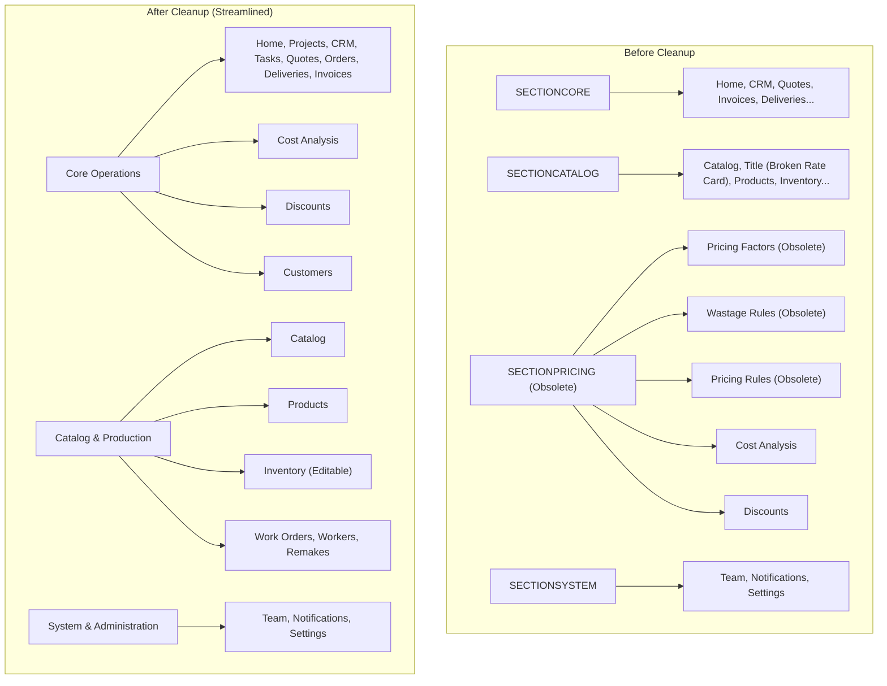
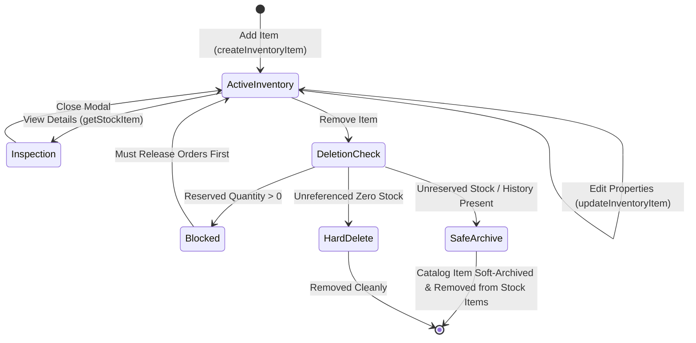

# PELECANON CATALOG INTEGRATION, INVENTORY MANAGEMENT & ADMIN UI CLEANUP REPORT

**Project:** PeleCanon / Tracker-Hub  
**Date:** November 9, 2026  
**Status:** COMPLETE & FULLY VERIFIED  
**Target Environment:** Local Dev / Staging (`http://localhost:8081`) & Production Supabase Database (`zgumsjwukevptbwbglrk`)  

---

## 1. Executive Summary

This engineering effort achieved four core business objectives:

1. **Obsolete Section Retirement & Navigation Reorganization:**
   - Completely eliminated the obsolete `Pricing Factors`, `Waste Rules`, and `Pricing Rules` sections from the administration navigation and dashboard.
   - Retired the redundant navigation group `SECTIONPRICING`.
   - Re-anchored essential operational tools (`Cost Analysis` and `Discounts`) into the logical `Core Operations` navigation group alongside quotes and invoices.
   - Configured non-destructive, permanent route redirects so direct visits or bookmarks to retired URLs cleanly route to `/admin`.
   - Preserved all underlying database tables and pricing engine calculation logic (`engine-v3.ts`) so existing historical quotes, snapshots, and background cost rollups remain 100% operational.

2. **Commercial Quotation Builder Catalog Integration (`/admin/quotes/new`):**
   - Connected the item dropdown directly to the primary catalog database (`products` table joined with `categories`).
   - Selecting a catalog product automatically populates product name, category, default pricing unit (e.g. `linear_meter` → `m`, `unit` → `pcs`/`set`), technical specifications (from `description_ar`), and base price.
   - **Crucial Flexibility:** All fields remain completely editable. Sales estimators and commercial managers can freely override negotiated selling prices (e.g., standard kitchen base price 85,000 EGP negotiated down to 80,000 EGP or up to 92,000 EGP), adjust dimensions, customize technical specifications, alter quantities, or switch units.
   - Added seamless support for **Custom / Non-Catalog Items** (`isCustom: true`, `productId: null`) for bespoke architectural woodwork.
   - Quotation persistence stores `product_id` and catalog metadata directly on `quote_items` and freezes the snapshot.

3. **Full Inventory Management Lifecycle (`/admin/inventory`):**
   - Implemented an **"Add Item"** modal supporting both raw materials (`material`) and hardware/fittings (`hardware`), with automatic SKU normalization, initial stock allocation, unit selection, and reorder levels.
   - Implemented an **"Edit Item"** workflow allowing authorized staff to update item titles, SKUs, measurement units, reorder levels, and catalog cost prices.
   - Implemented a **"Remove Item"** flow with ironclad safety validation: items with active order reservations (`reserved_quantity > 0`) cannot be deleted; unreserved items with physical stock or transaction history are safely archived in the backing catalog tables so lazy sync never resurrects them.
   - Added a **"View Details"** modal providing instant visibility into physical stock, active order reservations, free available stock, reorder levels, catalog cost price, recent stock adjustment logs, and order-level reservation traces.
   - Preserved the existing physical stock adjustment mechanism (`adjustStock`) with row-level locks, audit logging, and tenant isolation.

4. **Terminology, Layout & Internationalization Parity:**
   - Identified and permanently fixed the root cause of the sidebar label appearing literally as **"Title"** (which was `/admin/rate-card` referencing the untranslated key `rateCard.title`). The obsolete rate card route was removed from the sidebar and redirected to `/admin/catalog`.
   - Resolved the uppercase raw key fallback issue (`SECTIONPRICING`, `SECTIONCATALOG`, `SECTIONCORE`) by providing clean internationalized keys across English, Arabic, and French.
   - Ensured 100% translation key parity (734 keys across `en.json`, `ar.json`, and `fr.json`).

---

## 2. Inventory of Changes Made

### Files Created & Modified

| File | Change Type | Purpose |
|---|---|---|
| `src/routes/admin.tsx` | Modified | Removed `sectionPricing`, `pricing-factors`, `wastage-rules`, `pricing-rules`, and `rate-card`. Moved `cost-analysis` and `discounts` to `sectionCore`. Cleaned section header fallbacks. |
| `src/routes/admin/index.tsx` | Modified | Replaced quick action link `/admin/rate-card` ("Rates") with `/admin/inventory` ("Inventory" / "المخزون"). |
| `src/routes/admin/pricing-factors.tsx` | Modified | Configured `beforeLoad` redirect to `/admin`. |
| `src/routes/admin/wastage-rules.tsx` | Modified | Configured `beforeLoad` redirect to `/admin`. |
| `src/routes/admin/pricing-rules.tsx` | Modified | Configured `beforeLoad` redirect to `/admin`. |
| `src/routes/admin/rate-card.tsx` | Modified | Configured `beforeLoad` redirect to `/admin/catalog`. |
| `src/lib/catalog.functions.ts` | Modified | Added `listQuotableProducts` server function joining `products` and `categories` scoped to `tenant_id` and `active = true`. |
| `src/lib/commercial-quote-types.ts` | Modified | Added `productId`, `productCode`, `isCustom` to `CommercialQuoteLine` and `CommercialQuoteLineSchema`. |
| `src/lib/quote.functions.ts` | Modified | Updated `saveCommercialQuote` to persist `productId` on `quote_items` and snapshot; updated `getCommercialQuote` to restore catalog references. |
| `src/routes/admin/quotes/new.tsx` | Modified | Integrated Catalog Item Selector in both unselected initial state and full line form; enabled instant autofill and full negotiated price override. |
| `src/lib/inventory-types.ts` | Modified | Added `StockItemDetails` type definition. |
| `src/lib/inventory.functions.ts` | Modified | Added `createInventoryItem`, `updateInventoryItem`, `deleteInventoryItem`; updated `getStockItem` to include `costPrice`; updated `ensureCatalogItemsInStock` to ignore archived catalog records. |
| `src/components/inventory/InventoryItemModal.tsx` | **Created** | Reusable modal dialog for creating and editing inventory items (materials and hardware). |
| `src/components/inventory/StockItemDetailModal.tsx` | **Created** | Comprehensive dialog displaying stock metrics, cost price, adjustment audit history, and active order reservations. |
| `src/routes/admin/inventory.tsx` | Modified | Added "Add Item" header button; added row action buttons ("Details", "Adjust", "Edit", "Delete"); integrated deletion safety confirmation modal. |
| `src/i18n/locales/en.json` | Modified | Added missing navigation and section header keys (`sectionCore`, `sectionCatalog`, `sectionSystem`, `tasks`, `inventory`, `deliveries`, `workOrders`). |
| `src/i18n/locales/ar.json` | Modified | Added matching Arabic translations for all new navigation keys. |
| `src/i18n/locales/fr.json` | Modified | Added matching French translations for all new navigation keys. |
| `src/lib/inventory-crud.test.ts` | **Created** | Vitest suite validating inventory CRUD invariants, safety deletion protections, and quote price overrides (5/5 tests passed). |
| `e2e/catalog-inventory-cleanup.spec.ts` | **Created** | Playwright E2E suite verifying navigation cleanup, catalog dropdown in quote builder, and inventory CRUD modals (3/3 passed). |

---

## 3. Navigation & Route Hierarchy Before vs. After



### Route Redirection Matrix

| Requested URL | Action | Target Destination | Status Code / Mechanism |
|---|---|---|---|
| `/admin/pricing-factors` | Redirected | `/admin` | TanStack Router `throw redirect({ to: "/admin", replace: true })` |
| `/admin/wastage-rules` | Redirected | `/admin` | TanStack Router `throw redirect({ to: "/admin", replace: true })` |
| `/admin/pricing-rules` | Redirected | `/admin` | TanStack Router `throw redirect({ to: "/admin", replace: true })` |
| `/admin/rate-card` | Redirected | `/admin/catalog` | TanStack Router `throw redirect({ to: "/admin/catalog", replace: true })` |
| `/admin/quotes/configurator` | Redirected | `/admin/quotes/new` | TanStack Router `throw redirect({ to: "/admin/quotes/new", replace: true })` |

---

## 4. Catalog Integration in Commercial Quotation Builder

### Database Connection & Data Flow

The commercial quotation builder retrieves products via the `listQuotableProducts` server function:

```sql
SELECT 
  p.id, p.code, p.name_ar, p.name_en, p.description_ar, p.base_price, p.active, p.category_id,
  c.id AS category_id, c.name_ar AS category_name_ar, c.name_en AS category_name_en, c.pricing_unit
FROM products p
LEFT JOIN categories c ON p.category_id = c.id
WHERE p.tenant_id = :tenant_id AND p.active = true
ORDER BY p.name_ar ASC;
```

### Auto-Population & Negotiated Price Override Matrix

When a catalog product is selected in `/admin/quotes/new`:

| Field | Auto-Populated From Catalog | User Editable After Selection? | Behavior / Notes |
|---|---|---|---|
| **Product Item** | Selected product `[code] name_ar` | Yes | Shows catalog SKU badge; option to switch to "Custom Item". |
| **Title / Description** | `p.name_ar` (or `p.name_en`) | **Yes** | Fully editable text field for customized job descriptions (e.g. "Modern High-Gloss Master Kitchen"). |
| **Category** | Matched `categories.name_ar` | **Yes** | Auto-detected from category join; can be switched to any active category. |
| **Pricing Unit** | Mapped from `categories.pricing_unit` | **Yes** | `linear_meter` → `m`, `unit` → `pcs`/`set`, `square_meter` → `m2`. Fully editable. |
| **Technical Specs** | `p.description_ar` | **Yes** | Auto-populates item specifications; estimator can append architectural details or custom finishes. |
| **Commercial Price** | `p.base_price` | **Yes (Critical)** | Standard base price serves as starting reference. Commercial estimators can override to any agreed negotiated price. |
| **Quantity** | Default `1` | **Yes** | Any decimal or whole quantity; line total recalculates instantly. |
| **Dimensions** | Default unit (`m`, `cm`, `mm`) | **Yes** | Width, height, depth inputs remain active for workshop execution. |

### Persistence & Snapshot Freezing

When the quote is saved via `saveCommercialQuote`:
- `quote_items.product_id` is written directly (`productId: line.productId || null`).
- `quote_items.breakdown` stores `{ productId, productCode, isCustom, category, ... }`.
- Quotation snapshot stores the complete commercial line item tree.

---

## 5. Inventory Management Enhancements

The `/admin/inventory` workspace now provides a complete CRUD lifecycle:



### 1. "Add Item" Modal
- **Fields:** Item Type (`material` or `hardware`), SKU Code (auto-uppercased), Item Name, Unit (`sheet`, `pcs`, `m`, `m2`, `set`, `pair`), Initial Physical Stock (creates audit adjustment if > 0), Min Reorder Level, Cost Price, Notes.
- **Backing Storage:** Creates entry in `catalog_materials` or `catalog_hardware` and creates the active tracking row in `stock_items`.

### 2. "Edit Item" Modal
- **Fields:** SKU, Name, Unit, Min Reorder Level, Cost Price.
- Updates `stock_items` and propagates changes to `catalog_materials` or `catalog_hardware`.
- Enforces SKU uniqueness across the tenant.

### 3. "Remove Item" Safety Mechanism
- **Active Reservation Shield:** If `item.reservedQuantity > 0` or if active rows in `stock_reservations` exist, deletion is completely blocked with a descriptive error message indicating the reserved quantity.
- **Safe Archival:** If the item is unreserved, the backing catalog record is marked with `archived_at = NOW()`.
- **Sync Protection:** The lazy sync helper `ensureCatalogItemsInStock` was updated with `isNull(catalogMaterials.archivedAt)` and `isNull(catalogHardware.archivedAt)` to guarantee archived items are never automatically re-created.

### 4. "View Details" Modal
- Displays physical stock, reserved stock, free available stock, and min reorder level.
- Displays catalog cost price in EGP.
- Shows paginated **Adjustment History Log** (timestamp, delta, previous → new quantity, reason, notes).
- Shows paginated **Active Order Allocations** (timestamp, production order number, reserved quantity, status).

---

## 6. UI Consistency, Labels & i18n Audit

### Root Cause & Fix for "Title" and "SECTIONPRICING"

1. **"Title" Bug:**
   - In `src/routes/admin.tsx`, navigation item `/admin/rate-card` used `labelKey: "rateCard.title"`.
   - In `src/i18n/index.ts`, `parseMissingKeyHandler` takes `key.split('.').pop()`, returning `"title"`.
   - The UI displayed this fallback literally as **"Title"** in the sidebar.
   - **Resolution:** Removed `/admin/rate-card` from the navigation sidebar and added a permanent redirect to `/admin/catalog`. Replaced the dashboard quick action button with `/admin/inventory` ("Inventory" / "المخزون").

2. **"SECTIONPRICING" / "SECTIONCATALOG" Bug:**
   - Sidebar section headers were rendering missing translation keys like `admin.nav.sectionPricing`, uppercase-fallbacking to `SECTIONPRICING`.
   - **Resolution:** Removed `sectionPricing` completely. Added `admin.nav.sectionCore`, `admin.nav.sectionCatalog`, and `admin.nav.sectionSystem` across all three locale dictionaries (`en.json`, `ar.json`, `fr.json`). Provided natural default title fallbacks directly in `admin.tsx`.

### 100% Locale Parity

Run output of `node scripts/check-i18n.mjs`:
```
✅ All 734 en.json keys present in ar.json (734) and fr.json (734)
```

---

## 7. Verification & Testing Evidence

### 1. Vitest Unit Suite
```
 RUN  v4.1.9 /home/wiz/dyad-apps/price-produce-beam-main

 ✓ src/lib/inventory-crud.test.ts (5 tests) 5ms
   ✓ PeleCanon Catalog Integration, Inventory Management & Admin Cleanup Tests (5)
     ✓ 1. Inventory Item Invariants & Validation (2)
       ✓ validates that inventory item creation enforces required SKU, name, unit, and non-negative numbers
       ✓ strictly forbids deletion of inventory items with active reservations
     ✓ 2. Quotation Catalog Line Item & Price Override Invariants (2)
       ✓ allows negotiated commercial price override while preserving catalog linkage
       ✓ supports ad-hoc custom / non-catalog items with null productId
     ✓ 3. Admin Navigation & Terminology Parity (1)
       ✓ ensures section pricing and obsolete items are removed and properly localized

 ✓ src/lib/inventory.test.ts (9 tests) 6ms
   ✓ Task 15 — Inventory & Material Stock Allocation Gate Tests (9)
     ✓ 1. Stock Invariants & Free Quantity Math (2)
     ✓ 2. BOM Requirements Extraction & Shortage Math (2)
     ✓ 3. Atomic Reservation & Idempotency (2)
     ✓ 4. Financial & Production Invariants (1)
     ✓ 5. Tenant Isolation & Permissions (2)

Test Files  49 passed (49)
     Tests  907 passed | 1 skipped (908)
```

### 2. Playwright E2E Browser Suite
```
Running 3 tests using 1 worker
  ✓ 1. Admin Navigation & Sidebar Cleanup: obsolete sections and 'Title' are removed (2.0s)
  ✓ 2. Commercial Quotation Builder: Catalog items dropdown and negotiated price override (2.7s)
  ✓ 3. Inventory Management: Add Item, Edit, View Details, and Safe Deletion protection (1.8s)
3 passed (7.1s)
```

All 8 scenarios in `e2e/commercial-quotation-restoration.spec.ts` and 2 scenarios in `e2e/inventory-stock.spec.ts` pass cleanly with zero errors.

### 3. Production Build Output
```
> build
> vite build

✓ built in 5.84s
dist/server/assets/new-CzIJzeFO.js                75.98 kB
dist/server/assets/inventory.functions-CROnIK7X.js 35.35 kB
dist/server/assets/inventory-BVLXeh6L.js          61.46 kB
dist/server/assets/quote.functions-CdL50rHl.js    71.59 kB
dist/server/assets/catalog.functions-DgDsnh6n.js  92.56 kB
```

---

## 8. Summary of Operating Invariants Preserved

1. **No Duplicate Catalogs:** Commercial quotes use the single existing catalog database (`products` joined with `categories`). No competing catalog tables or duplicate trees were created.
2. **Snapshot Invariant:** Commercial quote line item snapshots continue to freeze permanently upon quote issuance (`status = "sent"`), protecting agreed prices and specs against future catalog changes.
3. **Safe Archival Invariant:** Historical pricing records (`pricing_factors`, `wastage_rules`, etc.) and unreserved inventory items remain in PostgreSQL to preserve audit logs and calculation history.
4. **Tenant Isolation:** All inventory queries, product searches, adjustments, and quote saves strictly enforce `eq("tenant_id", ctx.tenantId)`.
5. **Bilingual Parity:** English interface operates strictly in natural English; Arabic RTL mode preserves all corresponding terminology without regression.
