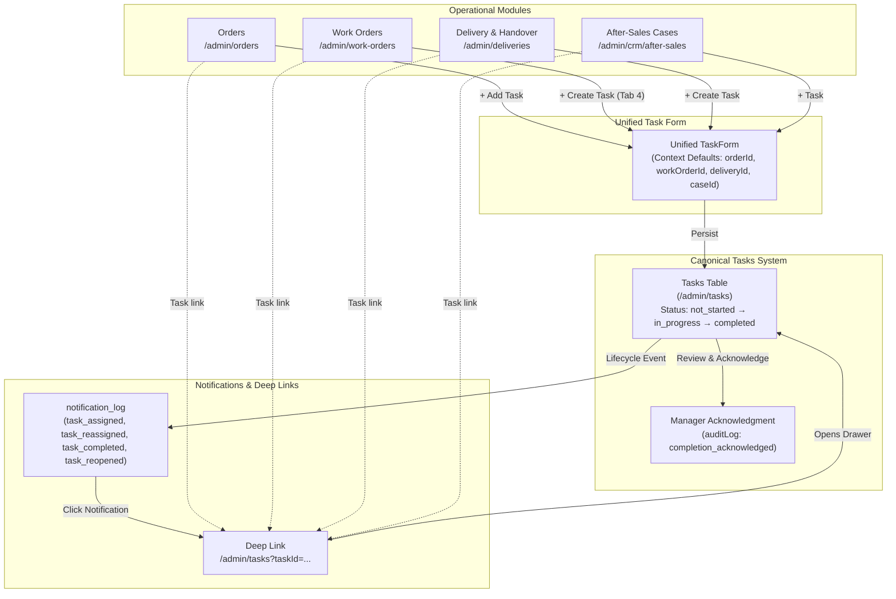
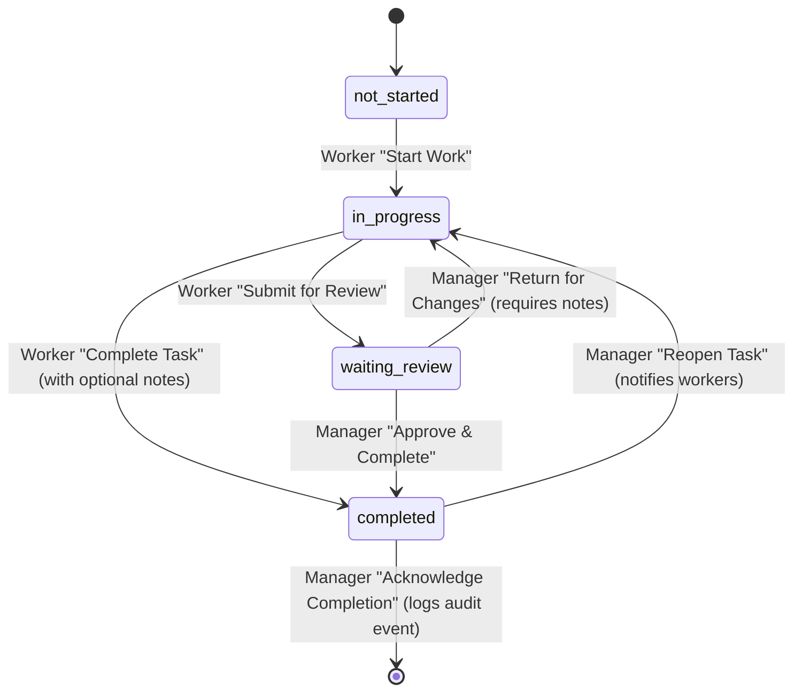

# PeleCanon Operational Task Workflow Integration — Verification Report

**Project:** PeleCanon / Tracker-Hub  
**Scope:** Operational Task Workflow Integration (`/admin/tasks`, `/admin/orders`, `/admin/work-orders`, `/admin/deliveries`, `/admin/crm/after-sales`)  
**Status:** COMPLETE & VERIFIED  
**Date:** 2026-11-10  
**Author:** Antigravity AI  

---

## 1. Executive Summary

The unified Task Management system has been directly connected to all four core operational pillars of the PeleCanon enterprise platform:
1. **Orders** (`/admin/orders`)
2. **Production & Work Orders** (`/admin/work-orders`)
3. **Delivery & Installation** (`/admin/deliveries`)
4. **After-Sales & Service Cases** (`/admin/crm/after-sales`)

Task Management now operates as the single authoritative mechanism for allocating, executing, reviewing, and auditing workforce responsibilities across the entire production and customer fulfillment lifecycle.

### Core Architecture Principles Enforced
- **Canonical Single Route (`/admin/tasks`)**: Zero duplicate or competing task engines. Zero "V1/V2/2.0" naming or legacy terminology.
- **Unified Dialog Pattern (`<TaskForm />`)**: Replaced all ad-hoc task creation dialogs with one single `<TaskForm />` component that accepts contextual defaults and automatically associates active operational records.
- **Strict Operational Independence**: Task completion or manager acknowledgment never advances or mutates the business state of an Order, Work Order, Delivery Handover, or Service Case.
- **Bidirectional Relational Linkage**: Full cross-referencing between tasks and operational records (`ORD-...`, `WO-...`, `DLV-...`, `CAS-...`, `RMK-...`) with deep-link navigation in both directions.
- **End-to-End Lifecycle Notifications**: Real-time structured in-app notifications on `notification_log` for task assignments, reassignments, completions, and supervisor reopenings with deduplication.

---

## 2. Operational Module Integrations



### 2.1. Orders (`/admin/orders`)
- **Integration Point**: `OrderTasksWidget` embedded within order detail view.
- **Context Injection**: Automatically injects `orderId`, `customerId`, and default category `production`.
- **Deep-Linking**: Each task card renders a direct link to `/admin/tasks?taskId=${task.id}`.
- **Display**: Shows live open/completed badges, task codes (`TSK-XXXX`), and due dates with overdue indicators.

### 2.2. Production & Work Orders (`/admin/work-orders`)
- **Integration Point**: `WorkOrderDetailDrawer` (Tab 4: Tasks).
- **Context Injection**: Prominent `+ Create Task` button opens `<TaskForm defaultWorkOrderId={wo.id} defaultOrderId={wo.orderId} defaultCustomerId={wo.customerId} defaultCategory="production" defaultTitle="${wo.workOrderNumber} - " onTaskSaved={refetch} />`.
- **Deep-Linking**: All linked work order tasks render clickable badges navigating to `/admin/tasks?taskId=${t.id}`.
- **Cut List & Operations Parity**: Seamlessly sits alongside the BOM Cut List (Tab 1), Industrial Operations (Tab 2), and Reserved Materials (Tab 3).

### 2.3. Delivery & Installation (`/admin/deliveries`)
- **Integration Point**: `DeliveryDetailDrawer` (Operational Tasks Section).
- **Context Injection**: `+ Create Task` button mounts `<TaskForm defaultDeliveryId={del.id} defaultOrderId={del.orderId} defaultCustomerId={del.customerId} defaultCategory="delivery" defaultTitle="${del.deliveryNumber} - " onTaskSaved={refetch} />`.
- **Deep-Linking**: Direct links to `/admin/tasks?taskId=${t.id}` with responsive status pills.
- **Stage Coverage**: Operational tasks can be issued across all stages: `ready_for_dispatch`, `dispatched`, `out_for_delivery`, `installation_pending`, and `installed`.

### 2.4. After-Sales & Service Cases (`/admin/crm/after-sales`)
- **Integration Point**: `ServiceCaseDetailDrawer`.
- **Elimination of Duplicate Forms**: Removed previous ad-hoc sub-modal and wired `+ Task` directly to canonical `<TaskForm defaultCaseId={caseData.id} defaultOrderId={caseData.orderId} defaultCustomerId={caseData.customerId} defaultCategory="after_sales_service" defaultTitle="Follow up: ${caseData.caseNumber} - ${caseData.title}" onTaskSaved={loadCase} />`.
- **Relational Mechanism**: On task creation with `caseId`, the backend atomically updates `service_cases.task_id = insertedTask.id` while setting `tasks.customer_id`, `tasks.order_id`, and `tasks.delivery_id`.
- **Bi-directional Querying**: `service_cases` is left-joined on `service_cases.taskId = tasks.id`, exposing `caseId`, `caseNumber`, and `caseTitle` to both `listTasks` and `getTaskById`.

---

## 3. Worker Execution & Manager Review Lifecycle



### 3.1. Worker Execution Flow ("My Tasks")
- **Assigned Workspace**: Workers only see tasks assigned to them (`role === "worker"`).
- **Actionability**: Workers can start unstarted tasks (`in_progress`) and complete active tasks (`completed`) with optional completion notes.
- **Safety Boundary**: Workers cannot reassign tasks, delete tasks, cancel tasks, or modify tasks belonging to other team members.

### 3.2. Manager Review & Acknowledgment Workflow
- **Completion Detection**: When a task is marked `completed` by a worker or supervisor, a `task_completed` notification is automatically dispatched to the task creator.
- **Acknowledgment Action (`acknowledgeTaskCompletion`)**: Managers and Admins can review the completed task in `TaskDetail` and click **"Acknowledge Completion"** (`تأكيد واعتماد الإنجاز`).
- **Audit Verification**: Records `action: "completion_acknowledged"` in `audit_log` with actor ID, timestamp, and notes. The drawer renders an authoritative green badge: **"Completion Acknowledged"** (`تم اعتماد الاكتمال من الإدارة`).
- **Supervisor Reopen (`task_reopened`)**: If work requires additional adjustments, managers can reopen a completed task back to `in_progress` with feedback notes, automatically dispatching `task_reopened` notifications to all assigned employees.
- **Operational Boundary**: Neither completion nor manager acknowledgment alters or advances the state of an Order, Work Order, Delivery, or Service Case.

---

## 4. Notifications & Audit Trail

| Trigger Event | Database Event Name | Target Recipient(s) | Payload Content |
|---|---|---|---|
| Task Created & Assigned | `task_assigned` | Newly assigned workforce members | `taskId`, `taskCode`, `title`, `priority`, `dueDate`, `actorName`, `deepLink` |
| Task Reassigned / Assignee Added | `task_reassigned` | Newly added assignees only (deduplicated) | `taskId`, `taskCode`, `title`, `priority`, `actorName`, `deepLink` |
| Task Marked Completed | `task_completed` | Task creator / Manager | `taskId`, `taskCode`, `title`, `note` (completion notes), `actorName`, `deepLink` |
| Task Reopened by Supervisor | `task_reopened` | All assigned workforce members | `taskId`, `taskCode`, `title`, `note` (reopen feedback), `actorName`, `deepLink` |
| Manager Acknowledged | `completion_acknowledged` | Audit Log (`audit_log` table) | `taskCode`, `actorId`, `acknowledgedAt`, `notes` |

---

## 5. Manager Operational Overview & Filtering

In the canonical `/admin/tasks` workspace, managers can slice tasks across the entire factory:
- **Module Filter Dropdown**:
  - `All Modules` (`كل الأقسام`)
  - `Orders` (`أوامر الإنتاج`) — Filters `tasks.order_id IS NOT NULL`
  - `Work Orders` (`أوامر التشغيل`) — Filters `tasks.work_order_id IS NOT NULL`
  - `Deliveries` (`التوصيل والتركيب`) — Filters `tasks.delivery_id IS NOT NULL`
  - `After-Sales` (`ما بعد البيع`) — Filters `service_cases.id IS NOT NULL OR tasks.remake_id IS NOT NULL OR category = 'after_sales_service'`
- **Live Search**: Full-text searching on task code, title, and description.
- **Status & Priority Filters**: Multi-criteria filtering supporting active and historical records.
- **Workload Indicators**: Displays live active, overdue, and waiting review counts per workforce member.

---

## 6. Verification & Quality Gates

### 6.1. TypeScript Compiler
```bash
npx tsc --noEmit
```
- **Result:** PASSED (Exit code 0, 0 type errors across all routes and components).

### 6.2. Vitest Unit & Integration Suite
```bash
npx vitest run src/lib/notifications.test.ts src/lib/tasks.test.ts
```
- **Result:** PASSED (38 tests passed in 666ms).
- **Full Project Vitest Suite:** PASSED (50/50 test files, 921 tests passed, 0 failures).

### 6.3. Playwright End-to-End Acceptance Suite
```bash
npx playwright test e2e/tasks-workflow-integration.spec.ts e2e/tasks-redesign.spec.ts
```
- **Scenario A (Orders Integration)**: PASSED — Verified contextual `OrderTasksWidget`, `+ Add Task` dialog, and deep links.
- **Scenario B (Work Orders Integration)**: PASSED — Verified Tab 4: Tasks, contextual `+ Create Task` button, and work order linking.
- **Scenario C (Delivery & Installation Integration)**: PASSED — Verified Delivery & Installation tasks section and creation flow.
- **Scenario D (After-Sales Integration)**: PASSED — Verified Service Case detail drawer task integration with canonical `<TaskForm />`.
- **Scenario E & G (Canonical Tasks & Module Filter)**: PASSED — Verified `/admin/tasks` canonical route, module filter options, and My Tasks workspace.
- **Scenario F (Completion & Manager Acknowledgment Lifecycle)**: PASSED — Verified task creation, execution (`in_progress`), worker completion dialog, and manager acknowledgment badge.
- **Regression Suite (`tasks-redesign.spec.ts`)**: PASSED (6/6 tests passed).

### 6.4. Production Build Verification
```bash
npm run build
```
- **Result:** PASSED (Vite v7.3.5 built client and server SSR bundles in 5.79s without errors).

---

## 7. Deliverables & Modified Files

- `src/lib/task-types.ts`: Extended `TaskItem` with operational relationships, `after_sales_service` category, and acknowledgment metadata.
- `src/lib/notifications.functions.ts`: Implemented `sendTaskLifecycleNotification` with deep linking and lifecycle events (`task_assigned`, `task_reassigned`, `task_completed`, `task_reopened`).
- `src/lib/tasks.functions.ts`: Added module filtering, service case bidirectional join, worker direct completion, manager review, and `acknowledgeTaskCompletion` endpoint.
- `src/components/tasks/TaskForm.tsx`: Unified contextual task creation supporting operational defaults (`defaultOrderId`, `defaultWorkOrderId`, `defaultDeliveryId`, `defaultCaseId`, `defaultCustomerId`, `defaultCategory`).
- `src/components/admin/OrderTasksWidget.tsx`: Connected customer defaults, contextual task form, and deep linking.
- `src/routes/admin/orders.tsx`: Passed `customerId` to `OrderTasksWidget`.
- `src/components/work-orders/WorkOrderDetailDrawer.tsx`: Added `+ Create Task` button and contextual task form in Tab 4.
- `src/components/deliveries/DeliveryDetailDrawer.tsx`: Embedded Operational Tasks card with contextual task creation and deep links.
- `src/components/after-sales/ServiceCaseDetailDrawer.tsx`: Replaced ad-hoc dialog with canonical `<TaskForm />` and deep-linked task cards.
- `src/components/tasks/TaskDetail.tsx`: Added Service Case operational link, worker completion dialog, manager acknowledgment button, and supervisor reopen dialog.
- `src/components/tasks/MyTasksView.tsx`: Rendered Service Case relation badges (`CAS-...`) alongside orders, work orders, remakes, and deliveries.
- `src/components/tasks/TaskFilterBar.tsx`: Added Operational Module filter dropdown (`All Modules`, `Orders`, `Work Orders`, `Deliveries`, `After-Sales`).
- `src/routes/admin/tasks.tsx`: Wired `module` filter state to `listTasksFn` query and search params.
- `src/lib/notifications.test.ts` & `src/lib/tasks.test.ts`: Added unit tests for lifecycle notifications and manager acknowledgment.
- `e2e/tasks-workflow-integration.spec.ts`: End-to-end Playwright acceptance test suite covering Scenarios A through G.
