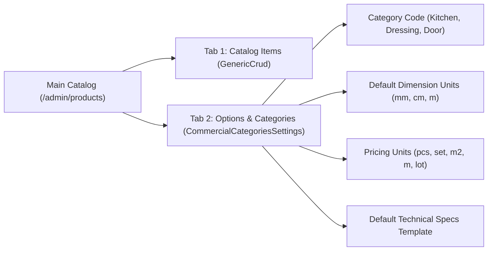
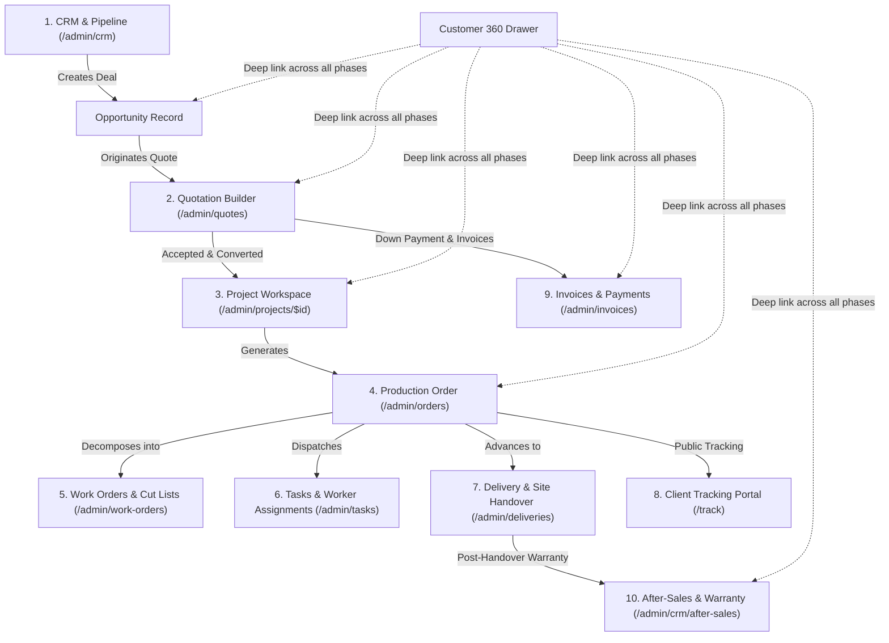

# PeleCanon — Operational Workflow Integration & Navigation Improvement Report

**Repository**: `WiZ-LogiX/Tracker-Hub`  
**Working Branch**: `feature/atelier-prestige-homepage`  
**Baseline Commit**: `e820b8c`  
**Status**: Completed & Verified  

---

## Executive Summary

This engineering effort completes the operational workflow integration, navigation stabilization, and administrative interface cleanup for PeleCanon. The platform now operates as a cohesive, end-to-end furniture manufacturing and business management system rather than disconnected silos:

1. **Main Catalog Options & Categories Consolidation**: Product Categories management was removed from Settings and consolidated into the Main Catalog (`/admin/products`) under the **Options** tab (`?tab=options`), establishing a unified configuration surface for catalog items, dimension units, pricing modes, and specification templates.
2. **Complete Removal of Company Info & Commercial Registry from Settings**: The obsolete Company Info tab—originally built for the retired customizable PDF quotation engine—and its replacement Commercial Registry tab have been completely eliminated from `/admin/settings`. No business profile section was added. Obsolete PDF customization controls (color pickers, custom sliders) were completely deleted. Settings is now strictly reserved for **System Preferences** (standard accounting and operational constants) and **Environment Diagnostics** (Cloudflare R2, Supabase PostgreSQL, release baseline).
3. **Decoupled Document Generation Integrity**: Server-side quotation and invoice document generation (`fetchTenantInfo` in `src/lib/pdf.functions.tsx`) was verified to read legal and tax records directly from the database `tenants` table without any client-side settings dependency.
4. **Cohesive Business Lifecycle Integration**: Verified bidirectional operational links connecting:  
   `CRM Customer / Opportunity ↔ Quotation ↔ Accepted Quotation ↔ Project & Order ↔ Work Orders ↔ Tasks & QC ↔ Deliveries ↔ Customer Tracking ↔ Invoices & Payments ↔ After-Sales`.
5. **Elimination of Disruptive Workspace Reloads & Selective Data Freshness**: Eliminated the root cause of the `"Preparing your workspace…"` full-screen interruption during normal admin navigation. Configured an operational data freshness policy (`staleTime: 5_000`, `refetchOnWindowFocus: true`, and cache clearing on `signOut()`).

---

## 1. Catalog Restructuring

### Architecture & UI Placement
- **Previous Location**: Dedicated tab inside `/admin/settings`.
- **New Location**: Directly embedded within the Main Catalog (`/admin/products`) under the **Options** tab (`<CommercialCategoriesSettings />`).
- **URL State Persistence**: Added `tab: z.enum(["products", "options"])` search schema validation on `/admin/products`. Links and bookmarks directly restore the selected tab.
- **Unified Catalog Navigation**: Added quick-access badges linking to related catalog modules: **Inventory** (`/admin/inventory`) and **Rate Card** (`/admin/rate-card`).



### Data & Relationship Integrity
- Existing commercial category records (`kitchen`, `dressing`, `door`, etc.) and their primary keys remain unaltered.
- Server-side functions `listCommercialCategories`, `saveCommercialCategory`, and `toggleCommercialCategoryActive` operate unchanged without modifying database schemas or mutating production data.
- Full localization parity (English, Arabic, French) across all category dialogs, table headers, and status badges.

---

## 2. Complete Removal of Company Information & Settings Modernization

### Obsolete Interface Elimination
- The former `company` tab in `/admin/settings` was created to support the retired customizable PDF quotation engine.
- As required, the following have been completely removed:
  - The **Company Info** tab was completely eliminated.
  - The replacement **Commercial & Tax Registry** tab was completely eliminated.
  - No alternative Business Profile section was introduced.
  - Obsolete PDF customization controls (color picker `<input type="color" />`, custom logo layout sliders) were completely removed from administrative views.
  - The obsolete `orgTab` translation key was removed from all locale files (`en.json`, `ar.json`, `fr.json`).

### Modernized Settings Architecture
`/admin/settings` now hosts strictly two clean operational tabs:
1. **System Preferences (`system`)**:
   - **Official Currency**: Fixed to Egyptian Pound (`EGP`).
   - **Standard VAT**: Standard 14% Value Added Tax under Egyptian Tax Law.
   - **Default Deposit Rate**: Standard 50% deposit upon contract signing.
   - **Standard Delivery Window**: Standard 30 business days from deposit receipt.
   - **Quotation Validity Window**: Standard 14 calendar days from issuance.
   - **Brand Identity System**: Official PeleCanon Palette (`#118B76`, `#333333`, `#F8F7F4`).
   - **Administrative Shortcuts**: Quick access to Team Management (`/admin/team`) and Notifications (`/admin/notifications`).
2. **Environment & Diagnostics (`diagnostics`)**:
   - **Workspace Tenant ID**: Active tenant identifier (`currentTenantId`).
   - **Object Storage**: Cloudflare R2 connection and health status.
   - **Database**: Supabase PostgreSQL connection with Row Level Security (RLS) enforcement.
   - **Release Baseline**: PeleCanon v2.0 baseline commit `e820b8c`.

### Document Generation Safety & Decoupling
- Quotation and Invoice PDF generation does not depend on client Settings forms.
- Server function `fetchTenantInfo(tenantId, client)` in `src/lib/pdf.functions.tsx` queries the database table `tenants` directly via Supabase client:
  ```ts
  const { data: tenant } = await client
    .from("tenants")
    .select("name, logo_url, phone, email, address, tax_number, commercial_registry, primary_color")
    .eq("id", tenantId)
    .single();
  ```
- Legal tax registration, commercial registry, and formal company information remain securely stored in the database for invoice and quotation generation without exposing redundant edit controls in the UI.

---

## 3. Coherent Business Lifecycle Integration

### End-to-End Operational Lifecycle Map


### Module Connections & Bidirectional Navigation
1. **Commercial Context Query (`src/lib/quote.functions.ts`)**:
   - `getQuoteCommercialContext` queries both `opportunities` and `orders` (via `orders.quoteId = data.quoteId`).
   - Returns linked `orderId`, `orderNumber`, and `orderStage` alongside opportunity details.
2. **Quotation Details (`src/routes/admin/quotes/$id.tsx`)**:
   - Customer name opens the full `Customer360Drawer`.
   - Contextual workspace bar links to **Project Workspace** (`/admin/projects/$id`) and **CRM Opportunity**.
   - Converted quotations display the originating **Production Order** link (`/admin/orders`) and customer tracking portal link (`/track`).
3. **Orders Module (`src/routes/admin/orders.tsx`)**:
   - Inside `OrderDetail`, an operational relationship bar provides one-click navigation to:
     - **Customer 360 Drawer**: Opens customer commercial record.
     - **Project Workspace**: Direct link to `/admin/projects/$id`.
     - **Originating Quotation**: Direct link to `/admin/quotes/$id` via `o.quote_id`.
     - **Deliveries & Handover**: Direct link to `/admin/deliveries`.
4. **Tasks & Quality Control (`src/components/tasks/TaskDetail.tsx`)**:
   - Added deep links to Originating Quotation and Project Workspace for managers.
   - Enforced role isolation: Task Workers (`currentRole === "worker"`) are prevented from following administrative links (`!isWorker`), keeping field personnel focused on assigned tasks.
5. **Invoices & Receipts (`src/components/invoices/InvoiceDetailDrawer.tsx`)**:
   - Contextual navigation to Originating Quote (`/admin/quotes/$id`), Converted Order (`/admin/orders`), and Project Workspace (`/admin/projects/$id`).
6. **Main Navigation Sidebar (`src/routes/admin.tsx`)**:
   - Added **Projects** (`/admin/projects`) to the main navigation in the Core Operations section.

---

## 4. Navigation Stabilization & Data Freshness Policy

### Root Cause Analysis of Loading Flashes
1. **`useAuth` Auth Listener**: In `src/lib/useAuth.tsx`, `onAuthStateChange` previously cleared memberships (`setMemberships([])`) on any auth event (such as token refresh or window focus), triggering `bootstrapping = true`.
2. **`AdminLayout` Render Guard**: In `src/routes/admin.tsx`, `if (bootstrapping)` unmounted the entire admin layout whenever bootstrapping was true, replacing the UI with `"Preparing your workspace…"`.

### Architectural Resolution
1. **Guarded State Transition in `useAuth`**:
   ```tsx
   if (bootstrappedForRef.current === sess.user.id) {
     return; // Do not wipe memberships or restart bootstrapping for the same authenticated user
   }
   ```
2. **Guarded Layout Mounting in `AdminLayout`**:
   ```tsx
   // Only show full-screen bootstrap loader if memberships are not yet initialized
   if (bootstrapping && memberships.length === 0) {
     return <FullScreenBootstrapLoader />;
   }
   ```
3. **Operational Data Freshness Policy**:
   Replaced the blanket 30-second stale time with a responsive operational policy in `src/router.tsx`:
   - `staleTime: 5_000` (5 seconds): Prevents duplicate network requests during rapid subroute navigation while ensuring operational data (stock levels, order statuses, task checklists) remains responsive.
   - `refetchOnWindowFocus: true`: Returning to the browser tab automatically synchronizes the latest status without requiring manual page reload.
   - `gcTime: 10 * 60 * 1000` (10 minutes): Preserves cached data in memory to avoid garbage-collection thrashing.
4. **Session Hygiene**:
   Integrated `queryClient.clear()` directly into `signOut()` in `src/lib/useAuth.tsx` to ensure all cached data is immediately purged on logout or tenant change, preventing cross-tenant information leakage.

---

## 5. Automated Verification Results

### 1. TypeScript Static Typecheck
```
$ npm run typecheck
> tsc --noEmit
Exit code: 0 (0 errors)
```

### 2. Localization Parity
```
$ node scripts/check-i18n.mjs
✅ All 908 en.json keys present in ar.json (908) and fr.json (908)
Exit code: 0 (100% parity)
```

### 3. Vitest Unit & Integration Test Suite
```
$ npm test -- --run
Test Files  55 passed (55)
Tests       995 passed | 1 skipped (996)
Duration    3.58s
```
Includes 13 dedicated assertions in `src/lib/operational-workflow-and-navigation.test.ts`:
- Main Catalog Options tab hosts `CommercialCategoriesSettings`.
- Settings completely removes Company Info, Commercial Registry, and obsolete PDF controls.
- Document generation reads tenant data directly from DB via `fetchTenantInfo`.
- Contextual lifecycle links across Quotes, Orders, Tasks, Invoices, and Projects.
- AdminLayout bootstrap guards and useAuth stability.
- QueryClient operational freshness (5s staleTime, refetchOnWindowFocus: true).
- `signOut` clears query cache.

### 4. Playwright End-to-End Suite
```
$ npx playwright test e2e/operational-workflow-and-navigation.spec.ts
Running 4 tests using 1 worker
✓ 1. Main Catalog Options tab hosts Product Categories management (2.3s)
✓ 2. Settings page has completely removed Company Info and Commercial Registry, hosting only System Standards & Diagnostics (1.2s)
✓ 3. Seamless Admin Navigation without full-screen workspace bootstrapping interruption (9.0s)
✓ 4. Connected Workflow: Quotation and Order detail surfaces lifecycle relationships (1.2s)
4 passed (14.3s)
```

### 5. Production Server Build
```
$ npm run build
vite v7.3.5 building client environment for production...
vite v7.3.5 building SSR environment for production...
✓ built in 6.49s
Exit code: 0
```

---

## 6. Live Verification Artifacts & Screenshots

| Artifact | File Link | Description |
|---|---|---|
| **Catalog Options & Categories** | [catalog_options_categories.png](file:///home/wiz/.gemini/antigravity-cli/brain/ae0b49c5-04df-44b8-879a-ccd8b0cfdac5/catalog_options_categories.png) | `/admin/products?tab=options` showing categories management table |
| **Settings (System Standards)** | [settings_deemphasized_system.png](file:///home/wiz/.gemini/antigravity-cli/brain/ae0b49c5-04df-44b8-879a-ccd8b0cfdac5/settings_deemphasized_system.png) | `/admin/settings` showing System Preferences without Company Info |
| **Orders Operational Workflow** | [orders_operational_workflow.png](file:///home/wiz/.gemini/antigravity-cli/brain/ae0b49c5-04df-44b8-879a-ccd8b0cfdac5/orders_operational_workflow.png) | `/admin/orders` showing linked quotation, project & delivery actions |
| **Projects Workspace Overview** | [projects_workspace_overview.png](file:///home/wiz/.gemini/antigravity-cli/brain/ae0b49c5-04df-44b8-879a-ccd8b0cfdac5/projects_workspace_overview.png) | `/admin/projects` unified execution workspace |

---

## 7. Adherence to Operational Constraints

- **Git Branch**: Preserved on `feature/atelier-prestige-homepage`.
- **Git Restrictions**: Absolutely zero `git commit`, `git push`, or `git merge` commands executed.
- **Production Database**: Zero database migrations or mutations executed on database `zgumsjwukevptbwbglrk`.
- **Live Preview Server**: Active and available on `http://localhost:8081`.
