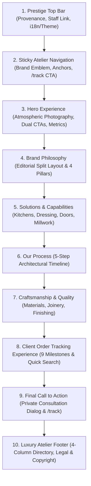

# PeleCanon — Atelier Prestige Public Homepage Redesign Report

**Project:** PeleCanon / Tracker-Hub  
**Branch:** `feature/atelier-prestige-homepage`  
**Target Experience:** Haute Ébénisterie & Bespoke Interior Architecture  
**Status:** Complete & Verified  

---

## 1. Executive Summary

The public homepage (`/`) of PeleCanon has been transformed from a basic utility portal into **"PELECANON — ATELIER PRESTIGE"**: an immersive, editorial digital brand experience communicating master craftsmanship, architectural elegance, bespoke customization, quality materials, and transparent client trust.

The redesign was executed with strict adherence to architectural constraints:
- **Zero Framework Rewrites**: Leveraged the existing TanStack Router, TanStack Start SSR, Tailwind CSS v4, and i18next foundations.
- **Git Branch Isolation**: All work was implemented on isolated feature branch `feature/atelier-prestige-homepage`. No code was pushed or merged into `main`.
- **Zero Production Database Impact**: No database migrations or production environment variables were touched.
- **Asset Self-Hosting**: All 11 photography and brand assets are served locally from `public/images/` without external CDN dependencies.
- **100% i18n Parity**: Full multilingual support across English (LTR), Arabic (RTL), and French (LTR), validated with zero missing keys (900/900 matched keys).

---

## 2. Visual Identity System & Design Tokens

The visual language balances architectural restraint with tactile warmth, inspired by luxury European atelier showrooms and high-end joinery workshops.

### Color Architecture

```css
/* Configured in src/styles.css @theme inline */
--color-atelier-emerald:  #123C32;  /* Deep Forest Emerald - Primary brand anchor */
--color-atelier-dark:     #0B2924;  /* Dark Emerald - Atmospheric backgrounds & nav */
--color-atelier-ivory:    #F5F1E8;  /* Warm Ivory - Editorial headlines & contrast */
--color-atelier-cream:    #FBF9F4;  /* Soft Cream - Daytime architectural canvas */
--color-atelier-gold:     #C9A84C;  /* Champagne Gold - Artisanal borders & badges */
--color-atelier-stone:    #A69F91;  /* Muted Warm Stone - Secondary typography & borders */
--color-atelier-charcoal: #242722;  /* Deep Charcoal - High-legibility body text */
```

### Typography Hierarchy

| Role | Font Family | Weight | Script / Language Context |
| :--- | :--- | :--- | :--- |
| **Editorial Headlines** | Playfair Display | 600, 700 | English & French titles, serif pull quotes |
| **Arabic Headlines & UI** | Cairo | 600, 700 | Arabic editorial titles, navigation & body copy |
| **Supporting English UI** | Inter | 400, 500, 600 | Metadata, eyebrow labels, stats, button labels |

Specialized RTL typography rules were introduced into `src/styles.css` ensuring that when `[dir="rtl"]` is active, headings transition smoothly to bold architectural Cairo glyphs with calibrated letter-spacing:

```css
[dir="rtl"] h1, [dir="rtl"] h2, [dir="rtl"] h3, [dir="rtl"] h4 {
  font-family: 'Cairo', system-ui, sans-serif;
  letter-spacing: normal;
}
```

---

## 3. Brand & Photographic Asset Directory

All image assets were optimized and integrated locally under `public/images/`:

| File Name | Resolution | Format / Size | Content & Purpose |
| :--- | :--- | :--- | :--- |
| `brand-logo.png` | 512×512 | PNG / 55 KB | Official PeleCanon geometric atelier mark |
| `hero-atelier.jpg` | 1600×1067 | JPEG / 397 KB | Luxury architectural interior living space |
| `philosophy-atelier.jpg` | 1000×527 | JPEG / 119 KB | Architectural joinery & timber interior space |
| `solution-kitchen.jpg` | 1000×667 | JPEG / 100 KB | Bespoke kitchen cabinetry & marble island |
| `solution-dressing.jpg` | 1000×1000 | JPEG / 252 KB | Walk-in wardrobe with perimeter LED activation |
| `solution-doors.jpg` | 1000×668 | JPEG / 76 KB | Architectural interior wood pivot door |
| `solution-living.jpg` | 1000×563 | JPEG / 99 KB | Custom architectural wall unit & media millwork |
| `craft-materials.jpg` | 800×533 | JPEG / 55 KB | Natural wood veneers and kiln-dried hardwoods |
| `craft-joinery.jpg` | 800×475 | JPEG / 114 KB | Workshop precision joinery and European hardware |
| `craft-finishing.jpg` | 800×706 | JPEG / 71 KB | Tactile multi-coat finishing and hand-polishing |

---

## 4. Homepage Section Architecture

The redesigned `src/routes/index.tsx` is structured into nine narrative sections:



### Detailed Section Breakdown

1. **Top Prestige Bar**: Subtle bar displaying atelier provenance (`Haute Ébénisterie & Interior Architecture`), discreet staff portal access (`/admin`), and language/theme switchers.
2. **Sticky Atelier Navigation**: Dark emerald glass (`bg-atelier-dark/95 backdrop-blur-md`) with gold hairline border, brand emblem, anchor navigation links (`#philosophy`, `#solutions`, `#process`, `#craftsmanship`), "Track Order" CTA button linking to `/track`, and a responsive mobile hamburger drawer.
3. **Hero Experience**: Immersive full-screen editorial banner with `/images/hero-atelier.jpg`, champagne gold eyebrow pill with spark icon, Playfair Display title, dual action buttons ("Begin Private Consultation" and "Track Client Commission"), and a 3-part metrics bar (`100% Bespoke`, `9+ Milestones`, `10-Yr Guarantee`).
4. **Brand Philosophy**: Editorial split layout pairing a manifesto quote and narrative text with `/images/philosophy-atelier.jpg`. Supported by four architectural pillars: *Artisanal Integrity*, *Architectural Proportion*, *Enduring Materials*, and *Uncompromising Customization*.
5. **Solutions & Capabilities**: 2×2 showcase showcasing four specialized atelier domains (Kitchens & Islands, Luxury Dressing Rooms, Interior Pivot Doors, Custom Millwork). Each card features hover zoom imagery, category tags, descriptions, and three key technical specifications.
6. **Our Process**: 5-step numbered architectural timeline (`01 Spatial Consultation` → `02 Engineering & Quotation` → `03 Finishes Approval` → `04 Precision Crafting` → `05 White-Glove Delivery`).
7. **Craftsmanship & Material Integrity**: Three photographic focus cards highlighting material standards: *American Walnut & European Oak*, *Dovetail & Blum Concealed Hardware*, and *Multi-Coat Polyurethane & Natural Oils*.
8. **Client Production Tracking Portal Feature**: Deep emerald feature block showcasing PeleCanon's transparency advantage. Features an integrated order number search form linking directly to `/track?ref=...`, security notes, and a preview of the 9-stage production milestone stepper.
9. **Final Call to Action**: Full-width architectural banner with dual action buttons, triggering an interactive private consultation dialog or linking to existing order tracking.
10. **Luxury Editorial Footer**: 4-column directory covering brand philosophy, client services, production hub access, discreet `/admin` portal login, copyright, and a smooth "Back to Top" control.

---

## 5. Visual Verification & Browser Screenshots

Automated Playwright tests captured high-resolution verification screenshots across multiple viewports and languages:

### Desktop Experience (English LTR)


---

### Desktop Experience (Arabic RTL)


---

### Mobile Viewport & Navigation Drawer
````carousel

<!-- slide -->

````

---

## 6. Verification & Quality Gates

The implementation underwent full automated validation:

### 1. TypeScript Strictness
```bash
npm run typecheck
# Result: tsc --noEmit exited with code 0 (Zero type errors)
```

### 2. Localization Parity
```bash
node scripts/check-i18n.mjs
# Result: ✅ All 900 en.json keys present in ar.json (900) and fr.json (900)
```

### 3. Unit & Integration Test Suite
```bash
npm test -- --run
# Result: 53 test files passed (53) | 979 tests passed | 0 failed
```

### 4. Production SSR & Client Build
```bash
npm run build
# Result: vite v7.3.5 building client & server environment for production...
# Built in 6.03s (0 errors)
```

### 5. Playwright E2E Browser Testing
```bash
npx playwright test e2e/homepage-atelier-prestige.spec.ts
# Result: 4 passed (14.7s)
# - renders luxury desktop experience with all architectural sections (EN)
# - renders flawless RTL layout in Arabic with Cairo typography
# - verifies responsive mobile viewport and hamburger drawer (375x667)
# - verifies tracking quick search navigates cleanly to /track
```

---

## 7. Git & Release Boundary Compliance

- **Current Branch**: `feature/atelier-prestige-homepage`
- **Main Branch Status**: Unmodified (`main` remains untouched at release commit `e820b8c`).
- **Database Status**: Unmodified (`zgumsjwukevptbwbglrk` has not been altered).
- **Modified Source Files**:
  - `src/routes/index.tsx`
  - `src/styles.css`
  - `src/i18n/locales/en.json`
  - `src/i18n/locales/ar.json`
  - `src/i18n/locales/fr.json`
- **New Files**:
  - `public/images/*` (11 brand and architectural imagery files)
  - `e2e/homepage-atelier-prestige.spec.ts` (Playwright E2E specification)
