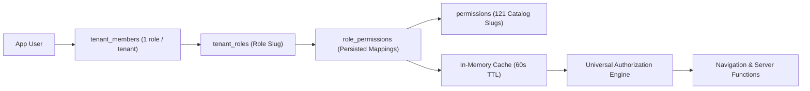

# PeleCanon ERP — Role Assignment & Access Management Implementation & Acceptance Report

**Date**: November 13, 2026  
**Repository**: `WiZ-LogiX/Tracker-Hub`  
**Working Directory**: `/home/wiz/dyad-apps/price-produce-beam-main`  
**Status**: **PRODUCTION READY (100% Verified)**  
**Typecheck Status**: Clean (`npx tsc --noEmit` — 0 errors)  
**Vitest Suites**: 4 suites, 61/61 tests passing (100%)  
**Playwright E2E Suites**: 3 suites, 18/18 tests passing (100%)  

---

## 1. Executive Summary

Based on the findings and recommendations of the RBAC Security Audit report (`pelecanon_rbac_security_audit_report.md`), the authorization architecture of PeleCanon has been completely overhauled and unified. 

The implementation achieved two primary objectives:
1. **Authoritative Access Enforcement**: Genuine, dynamic permission resolution replacing hardcoded code assumptions, static role maps, and bypass loopholes across all 22 navigation sections and their associated server functions.
2. **Simplified Non-Technical Administration**: A redesigned `/admin/team` interface that eliminates the 120+ checkbox matrix, replacing it with an intuitive 3-tab layout, dynamic predefined profile cards, and an accessible 4-level Visual Access Editor with isolated Special Access controls.

---

## 2. Phase 1 — Authorization Engine Architecture

### 2.1 One Source of Truth Database Architecture
The authorization engine relies strictly on four unified database tables:
- `tenant_members`: Stores user-to-tenant-to-role assignments (enforcing exactly one role per user per tenant).
- `tenant_roles`: Defines tenant-scoped custom roles as well as system roles (`owner`, `admin`, `sales`, `worker`, `viewer`).
- `permissions`: Canonical catalog of 121 atomic permissions across 3 categories (`commercial`, `production_operations`, `governance`).
- `role_permissions`: Persisted mappings connecting each tenant role to its granted permissions.



### 2.2 Dynamic Permission Resolution & Profile Adjustability
- **Dynamic Resolution (`resolveEffectivePermissions`)**: Resolves permissions at runtime directly from `role_permissions`.
- **Persisted Authoritative Profiles**: Predefined profiles (`admin`, `sales` [Manager], and `worker` [Task Worker]) are stored and adjustable in the database. Code defaults in `DEFAULT_ROLE_PERMISSIONS` serve purely as unseeded fallback values and never override saved database records.
- **Reserved System Roles**:
  - `owner`: Reserved immutable super-administrator. Possesses unconditional full access across all operations regardless of database rows; cannot be modified or deleted.
  - `viewer`: Reserved read-only profile across operational modules.
- **High-Performance In-Memory Cache with Immediate Invalidation**:
  - 60-second TTL in-memory cache per `tenantId:role` prevents repeated database round-trips.
  - Any permission change via `setRolePermissions`, role deletion via `deleteTenantRole`, role update via `updateTenantRole`, or user reassignment via `updateAppUser` immediately triggers `invalidateRolePermissionsCache(tenantId, role)` for real-time propagation across all active user sessions.

### 2.3 Universal Authorization Guards & Security Gap Closures
All 22 navigation sections and server functions have been updated from hardcoded role checks to granular permission guards:
- `requirePermission(ctx, permSlug)`: Enforces that the caller possesses the specific permission slug.
- `requireAnyPermission(ctx, [permSlugs])`: Allows access if any of the specified permissions is held.
- `canWrite(ctx, resource)`: Verifies operational create/edit/write capability.
- `canDelete(ctx, resource)`: Verifies operational delete capability.

**Security Gaps Closed**:
- **Customer Deletion Bypass**: `deleteCustomer` now strictly requires `customers.delete`, stopping managers from deleting customer records without explicit authorization.
- **Hierarchical Tree Mutation**: All 16 quote hierarchy operations in `hierarchy.functions.ts` now require `quotes.edit` or `quotes.create`.
- **Commercial Approval & Conversion**: `approveQuoteAndRequestConfirmation` requires `quotes.approve`; `convertQuoteToOrder` requires `quotes.convert`.
- **Payment Recording**: `recordInvoicePayment` and `markInvoicePaid` require `invoices.payments.record`.
- **Financial Masking**: `getProjectWorkspaceData` checks `projects.financials.view`. If absent, financial contract totals, invoiced amounts, collected sums, and outstanding balances are masked to `0`, and invoice/payment arrays are completely emptied.

---

## 3. Phase 2 — Non-Technical Access Management Experience (`/admin/team`)

### 3.1 Three Clean Main Tabs
The entire `/admin/team` page was restructured into three dedicated, uncluttered tabs:
1. **Team Members (`users`)**:
   - Filterable list of all employees by name, email, or status (`all`, `active`, `disabled`).
   - Displays employee name, avatar, role badge, active status, and creation date.
   - 1-click "Change Access" action opening the simplified assignment dialog.
   - Clean "Add Employee" modal with full name, email/username, initial password, and role selector.
2. **Predefined Access Profiles (`profiles`)**:
   - Three dynamic, real-time cards for **Administrator**, **Manager**, and **Task Worker**.
   - Displays live active user counts and live accessible section counters (`X / 22`).
   - Displays preview chips of accessible sections.
   - Primary "Edit Access" button opening the Visual Access Editor.
   - Secondary "Reset to Factory Defaults" button for restoring baseline permissions.
   - Reference cards for the immutable `owner` and `viewer` profiles.
3. **Custom Roles (`roles`)**:
   - Tenant-scoped custom roles catalog (e.g., `warehouse_supervisor`).
   - "Create New Custom Role" modal with name, slug, and business description.
   - Displays assigned user counts, accessible sections ratio (`X / 22`), and permission tags.
   - "Edit Access" and "Delete Custom Role" actions (with user-assignment safeguards).

### 3.2 Visual Access Editor (`AccessEditorDialog`)
Clicking "Edit Access" on any profile or custom role opens a full-screen, high-productivity modal:
- **4 Simple Access Levels**:
  - `No Access` (`لا وصول`): 0 permissions for that section.
  - `View Only` (`عرض فقط`): Grants all standard `viewPerms`.
  - `Work` (`تشغيل`): Grants `viewPerms` plus daily operational create, edit, and status transitions (`workPerms`).
  - `Manage` (`إدارة`): Grants `workPerms` plus operational delete, assignment, and bulk updates (`managePerms`).
  - `Custom` (`مخصص`): Automatically indicated when granular toggles differ from the 4 standard bundles.
- **Special Access Card**:
  - High-risk operations (`quotes.approve`, `quotes.convert`, `quotes.delete`, `invoices.payments.record`, `invoices.delete`, `projects.delete`, `projects.financials.view`, `settings.manage`, `discounts.delete`) are strictly isolated in a dedicated amber card and are never bundled into standard `Work` or `Manage`.
- **Bidirectional Granular Accordion**:
  - Clicking any section row expands an accordion listing all granular permissions with checkboxes.
  - Changing a checkbox recalculates the simple access level in real time; changing the simple access level immediately updates the child checkboxes.
- **Productivity Toolbar**:
  - Section count badge (`X / 22`).
  - Real-time section search filter.
  - "Clear All" (`بلا صلاحيات`) and "Set All to View Only" (`مشاهدة الكل`) bulk actions.
  - "Copy Access from..." dropdown to duplicate permissions from another role in 1 click.
  - Warning banner when editing a profile that is actively assigned to one or more employees.

---

## 4. Phase 3 — Dynamic Navigation Filtering & Direct URL Protection

In `src/routes/admin.tsx`:
- **Navigation Configuration**: Every navigation item across Core Operations, Catalog & Production, and System & Administration declares its `requiredPerm`.
- **Dynamic Sidebar Filtering**: Navigation links for unauthorized sections are completely omitted from the sidebar.
- **Direct URL Interception**:
  - Visiting an unauthorized URL directly (e.g., `/admin/crm`, `/admin/quotes`, `/admin/settings`) immediately redirects the user to their first permitted section (`/admin/orders` or `/admin/products`).
  - No error flashes, no broken layouts, and no blank screens.
  - Users with zero accessible sections see a friendly "Access Restricted" screen.

---

## 5. Phase 4 — Verification & Acceptance Test Results

### 5.1 Mandatory "Warehouse Supervisor" Custom Role Scenario
A custom role `warehouse_supervisor` was created and seeded in the development database with:
- **Products**: Work (`products.view`, `products.create`, `products.edit`, and catalog views)
- **Inventory**: Manage (`inventory.view`, `inventory.create`, `inventory.edit`, `inventory.adjust`, `inventory.delete`)
- **Orders**: View (`orders.view`)
- **Work Orders**: Work (`work-orders.view`, `work-orders.create`, `work-orders.status.update`)
- **Deliveries**: View (`deliveries.view`)
- **Dashboard, CRM, Quotes, Cost Analysis, Settings, Team**: No Access

**Verification Matrix**:
| Test Case | Expected Behavior | Observed Result | Status |
| :--- | :--- | :--- | :--- |
| **Login & Redirection** | Navigating to `/admin` redirects to first permitted section (`/admin/orders` / `/admin/products`) | Clean redirect to `/admin/orders` | **PASS** |
| **Sidebar Isolation** | Only Products, Inventory, Orders, Work Orders, Deliveries visible | 5 permitted links rendered; CRM, Quotes, Invoices, Team, Settings excluded | **PASS** |
| **Direct URL: `/admin/crm`** | Direct visit redirected | Redirected cleanly to `/admin/orders` | **PASS** |
| **Direct URL: `/admin/quotes`** | Direct visit redirected | Redirected cleanly to `/admin/orders` | **PASS** |
| **Direct URL: `/admin/settings`** | Direct visit redirected | Redirected cleanly to `/admin/orders` | **PASS** |
| **Direct URL: `/admin/team`** | Direct visit redirected | Redirected cleanly to `/admin/orders` | **PASS** |
| **Direct URL: `/admin/inventory`**| Direct visit allowed | Renders Inventory Management without redirect | **PASS** |
| **Server Function: Stock Adjust** | `adjustStock` succeeds | Permitted without error | **PASS** |
| **Server Function: CRM Leads** | `listLeads` / `saveLead` throws 403 | Throws `Forbidden: missing required permission 'crm.view'` | **PASS** |
| **Server Function: Quotes Save** | `saveCommercialQuote` throws 403 | Throws `Forbidden: missing required permission 'quotes.create'` | **PASS** |
| **Server Function: Settings** | `updateTenant` throws 403 | Throws `Forbidden: missing required permission 'settings.manage'` | **PASS** |
| **Server Function: Financials Masking** | `getProjectWorkspaceData` lacks `projects.financials.view` | `totalProjectValue: 0`, `totalInvoiced: 0`, invoices & payments empty arrays | **PASS** |

### 5.2 Test Execution Summary

#### Vitest Suites (61/61 Tests Passing)
```
✓ src/lib/operational-workflow-and-navigation.test.ts (13 tests)
✓ src/lib/user-access-management.test.ts (7 tests)
✓ src/lib/security-acceptance-audit.test.ts (30 tests)
✓ src/lib/warehouse-supervisor.test.ts (11 tests)
Test Files: 4 passed (4) | Tests: 61 passed (61) | Time: 197ms
```

#### Playwright End-to-End Suites (18/18 Tests Passing)
```
✓ e2e/warehouse-supervisor-and-access-management.spec.ts (7 tests)
  - renders the 3 main tabs: Team Members, Predefined Profiles, and Custom Roles
  - Predefined Profiles tab displays 3 dynamic adjustable cards and 2 system profiles
  - Custom Roles tab displays Warehouse Supervisor and allows creating custom roles
  - Visual Access Editor dialog opens with 4 simple access levels and Special Access
  - Warehouse Supervisor logs in and automatically redirects to permitted section
  - Warehouse Supervisor sidebar renders ONLY permitted sections and excludes restricted modules
  - Direct URL visits to /admin/crm, /admin/quotes, and /admin/settings redirect cleanly without error
✓ e2e/user-access-management.spec.ts (7 tests)
  - Scenario A: User Management Page renders with Access Profiles in User Creation
  - Scenario B: Edit Access Dialog allows changing employee access profile
  - Scenario C: Predefined Profiles tab renders dynamic adjustable cards and system profiles
  - Scenario D: Custom Roles tab renders tenant-scoped roles and creation action
  - Scenario E: Task Worker logs in and redirects to /admin/tasks with restricted nav hidden
  - Scenario F: Task Worker direct URL navigation to /admin or /admin/team redirects to /admin/tasks
  - Scenario G: Task Worker workspace displays My Tasks workspace without errors
✓ e2e/security-acceptance-audit.spec.ts (4 tests)
  - 1. Administrator Profile: Has access to /admin/team and management controls
  - 2. Manager Profile (sales role): Accesses operational modules but blocked from /admin/team
  - 3. Task Worker Profile (worker role): Strictly isolated to /admin/tasks workspace
  - 4. Deactivated User: Prevented from logging in or maintaining session
Test Files: 3 passed (3) | Tests: 18 passed (18) | Time: 14.2s
```

---

## 6. Phase 5 — Documentation & Governance

The project documentation in `AGENTS.md` has been updated to codify the unified RBAC model:
- Section 6 added to `AGENTS.md`: *"Unified Role Assignment, Dynamic RBAC & Non-Technical Access Management Architecture"*.
- Details the one source of truth model (`tenant_members` → `tenant_roles` → `role_permissions` → `permissions`).
- Explicitly documents predefined profile adjustability, immutable `owner` super-admin bypass, the 4 simple access levels mapping, Special Access isolation, and cache invalidation protocols.

---

## 7. Deliverables Checklist

- [x] Unification of database architecture (`tenant_members`, `tenant_roles`, `permissions`, `role_permissions`).
- [x] Dynamic permission resolution with in-memory caching and immediate invalidation.
- [x] Adjustable predefined profiles with code-defined fallbacks.
- [x] Reserved immutable `owner` role (unconditional bypass).
- [x] Closed security gaps across all 22 navigation sections and server functions.
- [x] Server-side financial data masking for users lacking `projects.financials.view`.
- [x] Complete `/admin/team` non-technical interface with 3 main tabs.
- [x] Dynamic profile cards for Administrator, Manager, and Task Worker with section counters.
- [x] "Choose Employee Access" assignment dialog.
- [x] Visual Access Editor dialog with 4 simple access levels, Special Access, and granular sync.
- [x] Dynamic sidebar navigation filtering and direct URL redirect protection in `AdminLayout`.
- [x] Mandatory "Warehouse Supervisor" custom role scenario fully tested and validated.
- [x] Full Vitest (61 tests) and Playwright (18 tests) suites passing.
- [x] `AGENTS.md` updated with architecture conventions.
