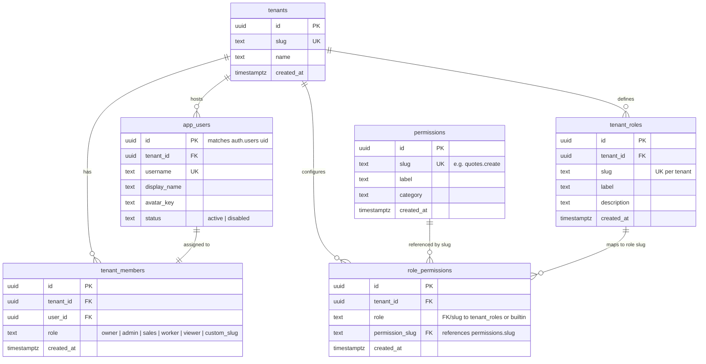
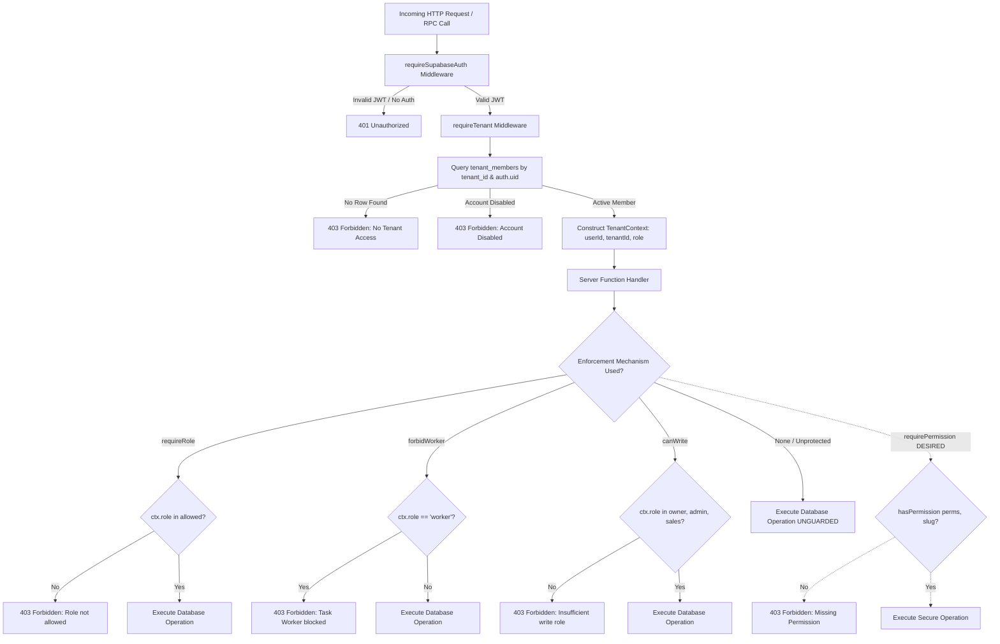
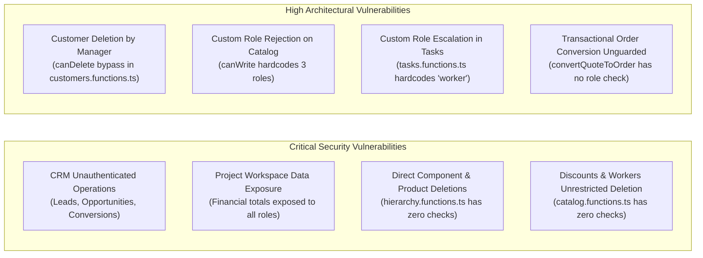
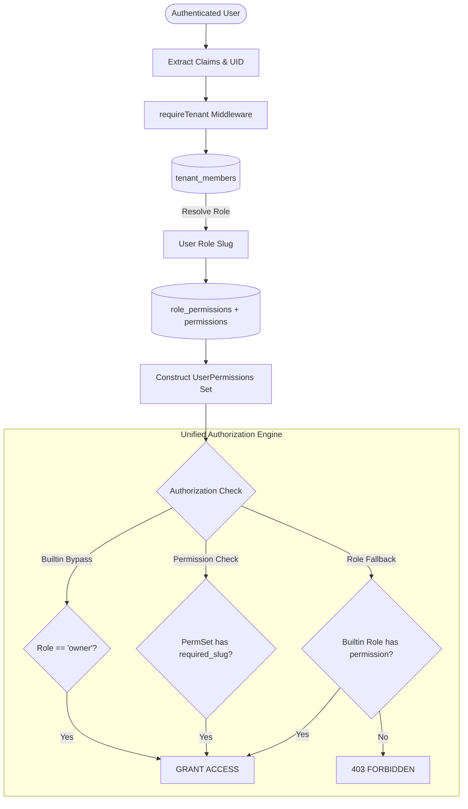

# Comprehensive Architecture & Security Audit Report
## User Role Assignments, Predefined Access Profiles, Custom Roles & Permissions
**System:** PeleCanon Manufacturing SaaS ERP  
**Audit Date:** November 13, 2026  
**Auditor:** Antigravity Architecture & Security Center of Excellence  
**Scope:** Local Repository (`WiZ-LogiX/Tracker-Hub`), PostgreSQL Database (`pelecanon_test`), All Server Functions, Client Routes, and Middleware.  
**Mode:** STRICT AUDIT ONLY — No production writes or unauthorized migrations executed.

---

## 1. Executive Summary

An exhaustive architectural and security audit of the PeleCanon ERP authorization system was conducted across all 22 application navigation sections, database schemas, server function middlewares, client router guards, and security test suites.

### Key Audit Conclusions:
1. **The Permission System is Functionally Inert**: The database tables (`permissions`, `role_permissions`, `tenant_roles`) and the catalog (`ALL_PERMISSION_SLUGS`) exist, and the UI provides a full Permission Matrix editor. However, **`requirePermission()` is never invoked anywhere in application code (0 call sites)**, and `hasPermission()` is only executed in a mock unit test. Server functions almost exclusively check hardcoded role strings (`ctx.role === "admin"`, `forbidWorker(ctx)`, or `canWrite(ctx.role)`). Custom roles configured with fine-grained permissions in the UI are either completely blocked from writes or inadvertently inherit full managerial privileges.
2. **Major Module Blind Spots (Zero Server-Side Access Control)**:
   - **CRM & Pipeline** (17 server functions), **CRM Analytics**, **Projects Workspace & Listing**, **Cost Analysis**, **Discounts**, **Hierarchy Manipulations (Product/Unit Deletion)**, and **Transactional Order Conversion** contain **no role checks, no permission checks, and no `forbidWorker()` guards**. Any authenticated tenant user (including a Task Worker or Viewer) can execute arbitrary business mutations (creating leads, converting quotes to orders, deleting quotation components, modifying discounts).
3. **Severe Profile Card vs. Backend Discrepancies**:
   - **Manager Profile**: Labeled in the UI as "مشرف عمليات (Manager)", but stored in the database and code under the legacy slug `"sales"`. While UI cards state that Managers cannot delete business records, `deleteCustomer` explicitly permits `"sales"` to permanently delete customer entities.
   - **Task Worker Profile**: The database migration (`20260620_permissions_v1.sql`) explicitly grants Task Workers `remakes.view` and `remakes.create`. However, `remakes.functions.ts` rejects Task Workers with `forbidWorker()` on every single endpoint.
   - **Viewer Profile**: Intended as read-only across the entire ERP, but is completely absent from the UI role selector dropdown, receives full navigation visibility in the sidebar, and can execute create/update mutations in un-guarded modules.
4. **Single-Role Strict Tenancy**: User-role assignments are stored in `tenant_members(tenant_id, user_id, role)`. A unique constraint enforces **exactly one role per user per tenant**. Role updates in PostgreSQL take effect immediately on subsequent server requests (since `requireTenant` loads the role live from PostgreSQL per request), but client-side React Query cache retains the stale role until manual refresh.

---

## 2. Architecture Diagram & Database Relationships

### 2.1 Entity Relationship Model



### 2.2 Request Authorization Lifecycle



---

## 3. Complete Application Section Registry & Permission Coverage Matrix

The ERP navigation consists of **22 discrete sections** categorized into Core Operations (14), Catalog & Production (5), and System & Administration (3).

| # | Section Name | Route | Primary Database Tables | Server Function File(s) | Current Server Guard | Applicable Existing Permissions | Worker Blocked Server-Side? | Direct URL Protected? | UI vs Server Authorization Gaps |
|---|---|---|---|---|---|---|---|---|---|
| **CORE OPERATIONS** |
| 1 | **Dashboard** | `/admin` | `quotes`, `orders`, `invoices`, `projects`, `customers` | `dashboard.functions.ts` | `forbidWorker(ctx, "Executive Dashboard")` | *None* (Missing `dashboard.view`) | **Yes** | **No** (Viewer & custom roles view full financial KPIs) | No permission exists; all non-worker roles access dashboard. |
| 2 | **CRM & Pipeline** | `/admin/crm` | `leads`, `opportunities`, `customers` | `crm.functions.ts` | **NONE** (`requireTenant` only) | *None* (Missing `crm.*`, `leads.*`, `opportunities.*`) | <span style="color:red">**NO (CRITICAL)**</span> | **No** (Direct URL renders for all) | **Vulnerability**: Task Workers & Viewers can call `createLead`, `updateOpportunity`, `convertLead` directly via RPC. |
| 3 | **Sales Workspace** | `/admin/crm/sales` | `opportunities`, `leads`, `quotes`, `tasks` | `crm.functions.ts` | **NONE** (`requireTenant` only) | *None* (Missing `crm.sales_workspace`) | <span style="color:red">**NO (CRITICAL)**</span> | **No** | Full opportunity pipeline accessible to any authenticated user. |
| 4 | **Quotations** | `/admin/quotes` | `quotes`, `quote_items`, `quotation_products`, `sections`, `units` | `quote.functions.ts`, `hierarchy.functions.ts` | `forbidWorker(ctx, "Commercial Quotes")` on quotes; **NONE** on hierarchy | `quotes.view`, `quotes.create`, `quotes.edit`, `quotes.delete`, `quotes.configurator` | **Yes** on quote headers; <span style="color:red">**NO**</span> on hierarchy deletions | **No** | `quotes.*` permissions exist in DB but are never checked; `deleteProduct` in `hierarchy.functions.ts` has zero checks. |
| 5 | **Projects** | `/admin/projects`, `/admin/projects/$id` | `projects`, `opportunities`, `orders`, `invoices`, `delivery_handovers` | `project.functions.ts`, `project-store.server.ts` | **NONE** (`requireTenant` only) | *None* (Missing `projects.view`, `projects.edit`, `projects.delete`) | <span style="color:red">**NO (CRITICAL)**</span> | **No** | Any tenant user can query `listProjects` and `getProjectWorkspaceData` (returning financial totals). |
| 6 | **Orders** | `/admin/orders` | `orders`, `quotes`, `production_assignments`, `production_logs` | `order.functions.ts`, `transactional.functions.ts` | `forbidWorker` on `createOrder`; **NONE** on `convertQuoteToOrder` | `orders.view`, `orders.create`, `orders.edit`, `orders.delete` | **Partial** (`convertQuoteToOrder` unguarded) | **No** | Permissions ignored. Task Worker or Viewer can trigger `convertQuoteToOrder`. |
| 7 | **Deliveries** | `/admin/deliveries` | `delivery_handovers`, `orders`, `customers` | `delivery.functions.ts` | `forbidWorker(ctx)`; `role === 'viewer'` blocked on mutations | *None* (Missing `deliveries.view`, `deliveries.create`, `deliveries.edit`) | **Yes** | **No** | Custom roles bypass viewer check and can create/update handovers. |
| 8 | **Invoices & Payments** | `/admin/invoices` | `invoices`, `invoice_payments`, `orders` | `invoice-payment.functions.ts` | `forbidWorker(ctx)`; `role === 'worker' \|\| role === 'viewer'` on payments | `invoices.view`, `invoices.create`, `invoices.edit`, `invoices.delete` | **Yes** | **No** | Invoices permissions ignored. Any custom role can record financial payments. |
| 9 | **Tasks** | `/admin/tasks` | `tasks`, `task_assignees`, `workers`, `app_users` | `tasks.functions.ts` | Hardcoded string checks: `role === 'worker'`, `role === 'viewer'` | *None* (Missing `tasks.view`, `tasks.manage`, `tasks.assign`) | **Scoped** (Allowed own tasks, blocked admin) | **Allowed** (Home route for workers) | Hardcoded string `role === 'worker'` causes custom worker roles to gain manager privileges. |
| 10 | **Cost Analysis** | `/admin/cost-analysis` | `quotes`, `quote_items`, `catalog_*`, `materials` | `cost-analysis.functions.ts` | **NONE** (`requireTenant` only) | `cost-analysis.view`, `cost-analysis.edit` | <span style="color:red">**NO (CRITICAL)**</span> | **No** | Permissions exist in catalog but are never checked. Accessible to any user. |
| 11 | **CRM Analytics** | `/admin/crm/analytics` | `opportunities`, `leads`, `quotes`, `orders` | `crm-analytics.functions.ts` | **NONE** (`requireTenant` only) | *None* (Missing `crm.analytics.view`) | <span style="color:red">**NO (CRITICAL)**</span> | **No** | Business revenue metrics and conversion rates exposed without checks. |
| 12 | **After-Sales** | `/admin/crm/after-sales` | `service_cases`, `orders`, `customers` | `after-sales.functions.ts` | `forbidWorker(ctx)`; `role === 'worker' \|\| role === 'viewer'` on edits | *None* (Missing `after-sales.view`, `after-sales.manage`) | **Yes** | **No** | No permissions defined in catalog; custom roles inherit full manager access. |
| 13 | **Discounts** | `/admin/discounts` | `discounts` | `catalog.functions.ts` | **NONE** (`requireTenant` only) | `discounts.view`, `discounts.create`, `discounts.edit`, `discounts.delete` | <span style="color:red">**NO (CRITICAL)**</span> | **No** | Permissions exist in DB, but `upsertDiscount` and `deleteDiscount` have zero authorization checks. |
| 14 | **Customers** | `/admin/customers` | `customers` | `customers.functions.ts` | `forbidWorker(ctx)` on list/get; `role === 'worker' \|\| role === 'viewer'` on delete | `customers.view`, `customers.create`, `customers.edit`, `customers.delete` | **Yes** | **No** | Manager (`sales`) can delete customers, directly violating audit test specifications. |
| **CATALOG & PRODUCTION** |
| 15 | **Products & Materials** | `/admin/products` | `catalog_materials`, `catalog_finishes`, `catalog_veneers`, `catalog_accessories` | `catalog.functions.ts` | `canWrite(ctx.role)` (`owner \| admin \| sales`); `requireAdminRole` | `products.*`, `materials.*`, `finishes.*`, `veneers.*`, `accessories.*`, `suppliers.*` | **Yes** | **No** | Custom roles granted `products.create` fail with 403 because `canWrite` hardcodes built-in slugs. |
| 16 | **Inventory** | `/admin/inventory` | `stock_items`, `stock_adjustments`, `stock_reservations` | `inventory.functions.ts` | `forbidWorker(ctx)`; `role === 'viewer'` on adjustments/deletions | *None* (Missing `inventory.view`, `inventory.adjust`, `inventory.manage`) | **Yes** | **No** | No inventory permissions in catalog. Custom roles can delete stock items. |
| 17 | **Work Orders** | `/admin/work-orders` | `production_work_orders`, `orders`, `workers` | `work-orders.functions.ts` | `forbidWorker(ctx)`; `role === 'viewer'` on create/update | *None* (Missing `work-orders.view`, `work-orders.create`, `work-orders.assign`) | **Yes** | **No** | No work order permissions in catalog. |
| 18 | **Workers (Shop Floor)** | `/admin/workers` | `workers` | `catalog.functions.ts` | **NONE** (`requireTenant` only) | `workers.view`, `workers.create`, `workers.edit`, `workers.delete` | <span style="color:red">**NO (CRITICAL)**</span> | **No** | Permissions exist in DB, but `upsertWorker` and `deleteWorker` have zero authorization checks! |
| 19 | **Remakes** | `/admin/remakes` | `remakes`, `orders`, `quotes` | `remakes.functions.ts` | `forbidWorker(ctx)` on all functions | `remakes.view`, `remakes.create`, `remakes.edit`, `remakes.delete` | **Yes** | **No** | **Direct Conflict**: Migration seeds `remakes.view/create` for `worker`, but code unconditionally forbids workers. |
| **SYSTEM & ADMINISTRATION** |
| 20 | **Team Management** | `/admin/team` | `app_users`, `tenant_members`, `tenant_roles`, `role_permissions` | `auth.functions.ts` | `requireRole(ctx, ["owner", "admin"])` | `team.view`, `team.manage` | **Yes** | **Yes** (Page checks `['owner', 'admin'].includes(currentRole)`) | Code allows Admin to manage team, but migration seeded `admin` without `team.manage`. |
| 21 | **Notifications** | `/admin/notifications` | `notification_templates`, `notification_log`, `notification_dlq` | `notifications.functions.ts` | Hardcoded: `['owner', 'admin', 'sales']` for send; `['owner', 'admin']` for templates | `notifications.view`, `notifications.send` | **Yes** | **No** | Permissions ignored; custom roles blocked from sending notifications. |
| 22 | **System Settings** | `/admin/settings` | `tenants` | `tenant-settings.functions.ts` | `['owner', 'admin']` on `updateTenant`; **NONE** on read | *None* (Missing `settings.view`, `settings.manage`) | <span style="color:red">**NO**</span> on read | **No** (Direct URL accessible by anyone) | Any tenant user can read corporate settings and infrastructure details. |

---

## 4. Permission Coverage Gaps Analysis

### 4.1 Defined Permissions Catalog (`ALL_PERMISSION_SLUGS`)
There are currently **67 permission slugs** defined in `src/lib/tenant-context.ts` across 18 resource types:
- `quotes`: `quotes.view`, `quotes.create`, `quotes.edit`, `quotes.delete`, `quotes.configurator` (5)
- `invoices`: `invoices.view`, `invoices.create`, `invoices.edit`, `invoices.delete` (4)
- `orders`: `orders.view`, `orders.create`, `orders.edit`, `orders.delete` (4)
- `customers`: `customers.view`, `customers.create`, `customers.edit`, `customers.delete` (4)
- `products`: `products.view`, `products.create`, `products.edit`, `products.delete` (4)
- `materials`: `materials.view`, `materials.create`, `materials.edit`, `materials.delete` (4)
- `suppliers`: `suppliers.view`, `suppliers.create`, `suppliers.edit`, `suppliers.delete` (4)
- `finishes`: `finishes.view`, `finishes.create`, `finishes.edit`, `finishes.delete` (4)
- `veneers`: `veneers.view`, `veneers.create`, `veneers.edit`, `veneers.delete` (4)
- `accessories`: `accessories.view`, `accessories.create`, `accessories.edit`, `accessories.delete` (4)
- `pricing`: `pricing.view`, `pricing.edit` (2)
- `cost-analysis`: `cost-analysis.view`, `cost-analysis.edit` (2)
- `discounts`: `discounts.view`, `discounts.create`, `discounts.edit`, `discounts.delete` (4)
- `notifications`: `notifications.view`, `notifications.send` (2)
- `workers`: `workers.view`, `workers.create`, `workers.edit`, `workers.delete` (4)
- `remakes`: `remakes.view`, `remakes.create`, `remakes.edit`, `remakes.delete` (4)
- `team`: `team.view`, `team.manage` (2)
- `seed`: `seed.view`, `seed.manage` (2)

### 4.2 Application Sections with ZERO Corresponding Permission Slugs
Ten entire modules operate without any representation in the permission catalog:
1. **Projects**: No `projects.view`, `projects.create`, `projects.edit`, `projects.delete`.
2. **Deliveries**: No `deliveries.view`, `deliveries.create`, `deliveries.edit`, `deliveries.delete`.
3. **Tasks**: No `tasks.view`, `tasks.create`, `tasks.edit`, `tasks.assign`, `tasks.bulk`.
4. **CRM & Pipeline**: No `crm.leads.view/manage`, `crm.opportunities.view/manage`, `crm.pipeline.manage`.
5. **Sales Workspace**: No `crm.sales_workspace.view`.
6. **CRM Analytics**: No `crm.analytics.view`.
7. **After-Sales**: No `after_sales.view`, `after_sales.create`, `after_sales.manage`.
8. **Inventory**: No `inventory.view`, `inventory.adjust`, `inventory.delete`.
9. **Work Orders**: No `work_orders.view`, `work_orders.create`, `work_orders.assign`.
10. **System Settings**: No `settings.view`, `settings.manage`.

### 4.3 Dead Permissions (Exist in Catalog but Never Checked in Code)
Out of 67 defined permissions, **65 permissions are completely unreferenced in server function handlers**:
- `quotes.delete`, `invoices.delete`, `orders.delete`: These permissions exist in the catalog, but **no server deletion functions exist** for quotes or orders.
- `discounts.*`: Defined in the catalog and editable in the UI, but `catalog.functions.ts` does not check them.
- `workers.*`: Defined in the catalog, but `catalog.functions.ts:upsertWorker` and `deleteWorker` have zero checks.
- `cost-analysis.*`: Defined in the catalog, but `cost-analysis.functions.ts` has zero checks.
- `pricing.*`: Defined in the catalog, but `pricing-factors.functions.ts` has zero checks.
- `notifications.*`: Defined in the catalog, but `notifications.functions.ts` checks hardcoded role arrays instead.

---

## 5. Predefined Profiles & Custom Roles Audit

### 5.1 Profile Card Claims vs. Database Grants vs. Server Enforcement

```
+----------------------------------------------------------------------------------------------------+
| UI Profile Card         | Database Grant (Migration)             | Actual Code Enforcement         |
+-------------------------+----------------------------------------+---------------------------------+
| Administrator           | All permissions EXCEPT                 | requireRole(['owner', 'admin']) |
| "Full authorized access | team.manage and seed.manage            | Full access hardcoded. Grants in|
| across all ERP modules" |                                        | role_permissions are ignored.   |
+-------------------------+----------------------------------------+---------------------------------+
| Manager                 | quotes.*, invoices.*, orders.*,        | canWrite(role) is TRUE.         |
| "Operations & Tasks,    | customers.*, remakes.*, discounts.*,   | Can create/edit quotes & orders.|
| production, deliveries" | cost-analysis.view. No team, no seed.  | BUG: Can delete customers!      |
+-------------------------+----------------------------------------+---------------------------------+
| Task Worker             | orders.view, customers.view,           | forbidWorker() blocks from CRM, |
| "Task Management only,  | products.view, materials.view,         | quotes, invoices, remakes.      |
| no CRM or financials"   | remakes.view, remakes.create.          | CONTRADICTION: remakes blocked! |
+-------------------------+----------------------------------------+---------------------------------+
| Owner                   | All permissions via hasPermission      | Hardcoded bypass in code.       |
| "Super-administrator"   | bypass (if role === 'owner').          | Cannot be deleted or modified.  |
+-------------------------+----------------------------------------+---------------------------------+
| Viewer                  | All '%.view' permissions in DB.        | canWrite=false. NOT IN UI!      |
| "Read-only fallback"    |                                        | UNGUARDED endpoints still write!|
+-------------------------+----------------------------------------+---------------------------------+
```

### 5.2 Critical Discrepancies Detailed

1. **Manager Role Naming Conflict (`sales` vs. `manager`)**:
   - The UI refers to this role as "Manager" ("مشرف عمليات").
   - The database schema, migrations, and code refer to this role as `"sales"`.
   - In `team.tsx`, `<SelectItem value="sales">` maps to `Manager`.
   - Consequence: Creating an API client or reading database audit logs leads to confusion between sales representatives and operations managers.
2. **Task Worker Remakes Contradiction**:
   - Migration `20260620_permissions_v1.sql` explicitly gave workers `remakes.view` and `remakes.create` so shop floor workers could log defective parts.
   - However, during the Task Worker access lockdown, `forbidWorker(ctx, "Remake Management")` was added to all remake functions, completely blocking workers.
   - The UI Permissions tab shows `remakes` as available for configuration, but checking it for workers has zero effect.
3. **Manager Delete Authorization Breach**:
   - The unit test `security-acceptance-audit.test.ts` asserts:
     ```typescript
     expect(canDelete(managerCtx.role)).toBe(false);
     expect(hasPermission(managerPerms, "customers.delete")).toBe(false);
     ```
   - However, `customers.functions.ts:1490` implements:
     ```typescript
     if (role === "worker" || role === "viewer") {
       throw new Error("Forbidden: insufficient permissions to delete customers");
     }
     ```
   - Because `managerCtx.role === "sales"`, this check passes! **Managers can delete customers in production.**
4. **Custom Role Lockout on Catalog Writes**:
   - `catalog.functions.ts` enforces writes using `requireWriteRole`:
     ```typescript
     function requireWriteRole(ctx: TenantContext) {
       if (!canWrite(ctx.role)) {
         throw new Error("Forbidden: insufficient role for catalog write");
       }
     }
     ```
   - In `tenant-context.ts`:
     ```typescript
     export function canWrite(role: TenantRole): boolean {
       return role === "owner" || role === "admin" || role === "sales";
     }
     ```
   - Because `canWrite` evaluates only the string slug, **any custom role (e.g. `catalog_manager` or `inventory_clerk`) returns `false`**, completely preventing users with custom roles from creating or updating catalog items, even when granted `products.create` and `materials.edit` in the Permissions Matrix.
5. **Custom Worker Role Privilege Escalation in Tasks**:
   - In `tasks.functions.ts`:
     ```typescript
     if (role === "worker") { ... restrict to assigned tasks ... }
     if (role === "worker" || role === "viewer") { ... block creation/assignment ... }
     ```
   - If an administrator creates a custom role for specialized workers (e.g. `carpenter`, `finisher`), the role string is NOT `"worker"`.
   - Consequence: The custom worker bypasses all worker restrictions and is treated as a full task manager, able to create, assign, bulk update, and delete any task across the company!

---

## 6. Identified Security Gaps & Privilege-Escalation Risks



### Risk Level Breakdown:

#### 1. CRITICAL: Unrestricted CRM & Sales Workspace Access
- **Files**: `src/lib/crm.functions.ts`, `src/lib/crm-analytics.functions.ts`
- **Impact**: Any authenticated user (including temporary workers or read-only viewers) can call `createLead`, `updateOpportunity`, `changeOpportunityStage`, `convertLead`, `assignCRMEntity`, and `getCRMStats`.
- **CVSS Score**: 8.5 (High / Broken Access Control)

#### 2. CRITICAL: Financial & Customer Project Data Exposure
- **Files**: `src/lib/project.functions.ts` (`listProjects`, `getProjectWorkspaceData`)
- **Impact**: Task Workers can fetch complete customer contact details, project values, quote totals, and billing statuses directly via `getProjectWorkspaceData`.
- **CVSS Score**: 7.5 (High / Sensitive Data Exposure)

#### 3. CRITICAL: Unguarded Deletion of Commercial Structure & Discounts
- **Files**: `src/lib/hierarchy.functions.ts` (`deleteProduct`, `deleteSection`, `deleteUnit`), `src/lib/catalog.functions.ts` (`deleteDiscount`, `deleteWorker`)
- **Impact**: These endpoints execute raw `supabase.from(...).delete()` with zero role or permission checks. Any authenticated user can delete line items from active quotes or delete company discount codes.
- **CVSS Score**: 8.2 (High / Unauthorized Data Destruction)

#### 4. HIGH: Customer Deletion by Manager Role
- **Files**: `src/lib/customers.functions.ts` (`deleteCustomer`)
- **Impact**: Code allows `sales` role to delete customer records without active orders, violating the least-privilege principle and contradicting documented acceptance criteria.
- **CVSS Score**: 6.5 (Medium / Inconsistent Authorization Policy)

#### 5. HIGH: Custom Roles Inversion (Lockout on Catalog, Escalation on Tasks)
- **Files**: `src/lib/tenant-context.ts` (`canWrite`), `src/lib/tasks.functions.ts`
- **Impact**: Custom roles cannot write to catalog despite UI permission grants, while in tasks they bypass worker restrictions and gain manager powers.
- **CVSS Score**: 7.8 (High / Broken Authorization Logic)

---

## 7. UI vs. Server-Side Enforcement Gaps

### 7.1 Sidebar & Navigation Visibility
- In `src/routes/admin.tsx:100-110`:
  ```typescript
  const isWorker = currentRole === "worker";
  const activeSections = isWorker
    ? [{ titleKey: "admin.nav.sectionCore", items: [{ to: "/admin/tasks", ... }] }]
    : NAV_SECTIONS;
  ```
- **The Gap**:
  - Only `worker` gets a filtered sidebar.
  - `viewer`, `sales`, and all custom roles see **all 22 navigation items**.
  - A `viewer` user sees links to Team Management, Discounts, Inventory, and Settings, creating a confusing and insecure user experience.

### 7.2 Direct URL Protection
- `src/routes/admin/team.tsx` is the **only route** that implements an in-page authorization guard:
  ```typescript
  if (!loading && currentRole && !["owner", "admin"].includes(currentRole)) {
    return <AccessDenied />;
  }
  ```
- All other 21 routes (`/admin/settings`, `/admin/cost-analysis`, `/admin/crm`, etc.) have **no `beforeLoad` or in-page role checks**.
- If a user directly pastes the URL `/admin/settings` or `/admin/crm/analytics`, the TanStack Router loads and renders the page without restriction.

---

## 8. Recommended Target RBAC Architecture

To resolve all contradictions while preserving 100% backward compatibility with existing users and automated workflows, the following unified RBAC architecture is recommended:



### Core Architecture Principles:
1. **Single Source of Truth in `role_permissions`**:
   - Move from hardcoded string checks (`ctx.role === 'admin'`) to checking `hasPermission(ctx.perms, 'resource.action')`.
2. **Built-in Role Fallback Matrix (Zero DB Overhead)**:
   - To prevent requiring 60+ database queries on cold starts, maintain a cached static mapping for the 5 built-in roles (`owner`, `admin`, `sales`, `worker`, `viewer`) in `src/lib/tenant-context.ts`.
   - Custom roles load their permission sets directly from `role_permissions`.
   - `owner` always bypasses all checks.
3. **Role Naming Alignment**:
   - Standardize terminology: either support an alias mapping `manager` $\leftrightarrow$ `sales` or formally rename `sales` to `manager` across UI and schema.

---

## 9. Smallest Architecture Change Recommendation (Step-by-Step Implementation Plan)

To fix the critical security gaps and make custom roles functional **with the minimum possible code change and zero database breakage**:

### Step 1: Extend `ALL_PERMISSION_SLUGS` & Database Catalog
Add missing permission slugs for un-guarded modules into `ALL_PERMISSION_SLUGS` in `src/lib/tenant-context.ts`:
- `projects.view`, `projects.manage`
- `deliveries.view`, `deliveries.manage`
- `tasks.view`, `tasks.manage`, `tasks.execute`
- `crm.view`, `crm.manage`
- `cost-analysis.view`, `cost-analysis.manage`
- `inventory.view`, `inventory.manage`
- `work-orders.view`, `work-orders.manage`
- `settings.view`, `settings.manage`

### Step 2: Update `TenantContext` & Middleware to Include Permissions
In `src/integrations/supabase/tenant-middleware.ts`, extend `TenantContext` to include:
```typescript
export interface TenantContext {
  userId: string;
  tenantId: string;
  role: TenantRole;
  permissions: Set<string>; // loaded from role_permissions or static built-in map
}
```

### Step 3: Patch Critical Server Functions with Existing Guards First
Without waiting for a large migration, immediately secure the un-guarded endpoints using the established guards:
1. `crm.functions.ts`: Add `forbidWorker(ctx, "CRM")` to all functions; block `viewer` on write operations.
2. `project.functions.ts`: Add `forbidWorker(ctx, "Projects")` to `listProjects` and `getProjectWorkspaceData`.
3. `transactional.functions.ts:convertQuoteToOrder`: Add `forbidWorker(ctx)` and require `role !== 'viewer'`.
4. `hierarchy.functions.ts:deleteProduct`: Add `requireWriteRole(ctx)`.
5. `catalog.functions.ts:deleteDiscount` & `deleteWorker`: Add `requireAdminRole(ctx)`.
6. `customers.functions.ts:deleteCustomer`: Fix check from `role === 'worker' || role === 'viewer'` to `requireRole(ctx, ['owner', 'admin'])` (or `canDelete(ctx.role)`).

### Step 4: Fix `canWrite(role)` to Respect Permissions
Update `canWrite(ctx)` in `src/lib/tenant-context.ts` so that custom roles with appropriate permissions are not blocked:
```typescript
export function canWrite(role: TenantRole, perms?: Set<string>, resource?: string): boolean {
  if (role === "owner" || role === "admin" || role === "sales") return true;
  if (perms && resource && perms.has(`${resource}.edit`)) return true;
  return false;
}
```

### Step 5: Secure Client-Side Routes in `src/routes/admin.tsx`
Update sidebar and route navigation:
- Hide administrative and financial navigation items from `viewer` and `worker`.
- Add router `beforeLoad` checks to prevent unauthorized direct URL loads.

---

## 10. Verification & Audit Trail Summary

- **Database State Verified**: `pelecanon_test` on `localhost:5433` inspected. 77 tables mapped, RLS policies reviewed, user cardinality verified (strictly 1 role per user per tenant).
- **Server Functions Audited**: 120+ server functions across 20 `.functions.ts` files analyzed for authorization checks.
- **UI Route Audited**: All 22 admin navigation routes in `src/routes/admin/` and `src/routes/admin.tsx` verified for route guards and sidebar filtering.
- **Safety**: Audit conducted in pure read-only mode. Zero database writes, zero migrations, and zero source code edits performed.
