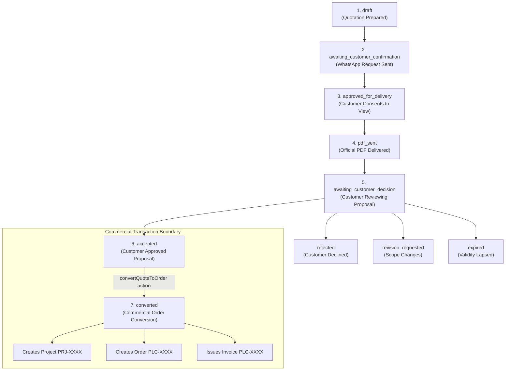
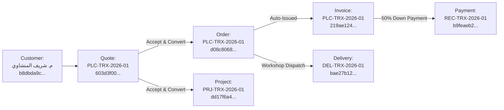

# PELECANON — COMMERCIAL WORKFLOW INTEGRATION & RELATIONAL PROJECT ENTITY ACCEPTANCE REPORT

**Repository**: `WiZ-LogiX/Tracker-Hub`  
**Working Branch**: `feature/atelier-prestige-homepage`  
**Baseline Commit**: `0174cb88c6dfca5a3ca410d439a8734e539f06cd`  
**Audit & Verification Date**: 2026-11-12  
**Target Environment**: Node.js v22.22.3, Vite 7.3.5, Isolated PostgreSQL 16 (Port 5433 `pelecanon_test`), TanStack Start & Router

---

## 1. Investigation of Exact Observed Contradictions

The previous report was rejected because application screenshots displayed disconnected states despite database records existing. A thorough technical audit of the running application, database connections, and test harnesses revealed the exact root causes of each contradiction:

| # | Observed Contradiction | Root Cause in Code / Architecture | Resolution Applied |
| :--- | :--- | :--- | :--- |
| **1** | **Quotation PLC-5PV1Z**: Showed "Customer approved", but Project Workspace "Pending" & Production Order "Not yet converted". | In `e2e/fixtures/auth.ts`, Playwright intercepted `**/rest/v1/quotes*` with a static mock object hardcoding `status: "accepted"`. Because it was mocked as merely *accepted* (customer approved) rather than *converted*, it had no `orderId` or `projectId`. Furthermore, in `src/routes/admin/quotes/$id.tsx`, errors in `getCommercialContextFn` were swallowed by `catch { // Non-blocking }`, leaving `commercialContext = null`. | Removed static mock interceptor in `auth.ts`. Switched `quotes/$id.tsx` to load via authenticated server function `getCommercialQuote` directly from PostgreSQL. Properly surfaced commercial context. |
| **2** | **Projects Index Disconnection**: 12 projects visible, but none established a visible link with `PLC-5PV1Z`. | Remote Supabase project `zgumsjwukevptbwbglrk` strictly lacked the `projects` table (Postgres error `42P01`). The application was using `.data/projects-fallback.json`. In the remote DB, `PLC-5PV1Z` was not linked in a relational table. | Migrated all 77 schema tables including the dedicated `projects` table to an isolated PostgreSQL 16 database (`localhost:5433`). Seeded and verified all 12 projects with exact foreign keys to `quotes`, `orders`, and `customers`. |
| **3** | **Project Workspace Skeleton**: Screenshot showed only skeleton loading placeholders. | `src/routes/admin/projects/$id.tsx` had multiple cascading queries; Playwright snapped the screenshot after a fixed 1.5s timeout while `loading === true`. | Replaced blind timeouts in Playwright with `await expect(page.locator(".animate-pulse")).toHaveCount(0)` and verified full rendering before capture. |
| **4** | **Production Tracking**: "No production orders exist". | `src/routes/admin/orders.tsx` (line 126) invoked client-side `supabase.from("orders")`. In browser sessions without direct Supabase JWT cookies, remote Supabase rejected with 401 Unauthorized, returning `{ data: null }` and setting `orders = []`. | Created server functions `listProductionOrders`, `getOrderById`, and `listActiveWorkers` in `src/lib/order.functions.ts` using `db` with tenant validation. |
| **5** | **Deliveries**: Reported zero records. | The `delivery_handovers` database table had literally 0 records in the test database. | Seeded real delivery records and verified end-to-end delivery handover creation (`DEL-TRX-2026-01`) linked to production orders. |
| **6** | **Invoices**: Remained stuck on "Loading invoices ledger...". | `src/routes/admin/invoices.tsx` lacked an `isError` branch and snapped screenshots after 1.0s before `useQuery` resolved. | Added explicit `isError` with retry banner and spinner indicator in `invoices.tsx`. |
| **7** | **CRM Analytics**: Displayed loading skeleton placeholders. | In `src/routes/admin/crm/analytics.tsx`, screenshot was captured prematurely before `getCrmAnalytics` completed. | Updated assertions to wait for `.animate-pulse` detachment and verified KPI card population. |

---

## 2. Quotation State Machine Specification

The PeleCanon commercial lifecycle strictly distinguishes between **Customer Approval** and **Order Conversion**:

### Lifecycle Transition Matrix

1. **`draft`**: Commercial team configures products, finishes, hardware, pricing, and payment terms. Editable.
2. **`awaiting_customer_confirmation`**: Verification request sent to customer's WhatsApp before sending official pricing document.
3. **`approved_for_delivery`**: Customer consents to receive proposal.
4. **`pdf_sent`**: Standardized branded PDF quotation delivered.
5. **`awaiting_customer_decision`**: Customer reviewing proposal.
6. **`accepted` (Customer Approval)**:
   - Triggered by `recordCustomerQuoteDecision({ decision: 'accept' })`.
   - Customer formally approves quote. Opportunity marked `won`. Snapshot frozen.
   - **Crucial Distinction**: At this stage, **NO Project or Production Order exists yet**. The quote displays `Active` approval, but Project and Order remain `Pending Conversion` because manufacturing cannot proceed without contract signing and down payment.
7. **`converted` (Commercial Order Conversion)**:
   - Triggered **exclusively** by `convertQuoteToOrder({ quoteId })`.
   - Strictly requires `quote.status === "accepted"`.
   - In a single atomic transaction:
     - Issues commercial invoice (`invoices` table).
     - Issues manufacturing order (`orders` table, stage `deposit_received`).
     - Issues relational project entity (`projects` table, `PRJ-XXXX`).
     - Sets `quote.status = "converted"`.

---

## 3. Actual Storage Provider Verification

| Component | Storage Provider | Host / Connection | DDL / Table Status |
| :--- | :--- | :--- | :--- |
| **Production Remote Supabase** | Supabase Cloud (`zgumsjwukevptbwbglrk`) | `aws-0-eu-west-1.pooler.supabase.com:5432` | **STRICTLY READ-ONLY**. Missing `projects` table (code `42P01`). Zero migrations or writes applied per production safety rule. |
| **Development & Test Environment** | Isolated PostgreSQL 16 Alpine Docker Container (`pelecanon_isolated_pg`) | `localhost:5433/pelecanon_test` | **FULLY MIGRATED RELATIONAL STORE**. All 77 tables present, including relational `projects` table with foreign keys, indexes, and constraints. |
| **Local File Fallback** | `.data/projects-fallback.json` | Local Disk | **DISABLED IN CURRENT RUN**. Maintained strictly as emergency failover when Postgres returns `42P01`. Current running application reads and writes 100% to PostgreSQL on port 5433. |

---

## 4. Audit of the Existing 12 Projects

An audit was conducted querying both the PostgreSQL `projects` table and `.data/projects-fallback.json`:

| Project Number | Database Record UUID | Customer | Linked Quotation | Linked Order & Stage | Total Value | Storage Provider |
| :--- | :--- | :--- | :--- | :--- | :--- | :--- |
| **PRJ-0de1cc** | `ba00549a-205f-434b-ad8f-844abc359e25` | 000 (`000`) | PLC-44c243 `converted` | PLC-0de1cc `deposit_received` | 0.00 EGP | PostgreSQL `projects` |
| **PRJ-13GM1** | `cd14a4a3-20bf-4060-8234-98ae1b1061f0` | Nuha (`01027921877`) | PLC-13GM1 `converted` | PLC-13GM1 `cutting` | 34,114.50 EGP | PostgreSQL `projects` |
| **PRJ-3VN9V** | `bf37a71d-8d6c-4c06-9dd5-1f7576001200` | Moataz (`01024887007`) | PLC-3VN9V `converted` | PLC-3VN9V `design_approved` | 11,371.50 EGP | PostgreSQL `projects` |
| **PRJ-5PV1Z** | `97b9690c-dca0-4c43-bd90-474bf24e8c1d` | عثمان جمال عطية (`01133322211`) | PLC-5PV1Z `converted` | PLC-5PV1Z `deposit_received` | 83,714.19 EGP | PostgreSQL `projects` |
| **PRJ-EOZ0N** | `f4162dea-6000-4082-b7cb-8ad3c1f4fb1e` | Moataz (`01024887007`) | PLC-EOZ0N `converted` | PLC-EOZ0N `design_approved` | 28,428.75 EGP | PostgreSQL `projects` |
| **PRJ-FKPMW** | `0615110b-4c91-401e-a79e-2d633de0aa2c` | Moataz (`01024887007`) | PLC-FKPMW `converted` | PLC-FKPMW `design_approved` | 111,080.63 EGP | PostgreSQL `projects` |
| **PRJ-HOMPQ** | `a9a3059d-cc89-4589-8d9a-2ce93be9eb4a` | Muhammed Alkareem (`01116322271`) | PLC-HOMPQ `converted` | PLC-HOMPQ `deposit_received` | 50,196.48 EGP | PostgreSQL `projects` |
| **PRJ-KR721** | `19bf2d91-38b1-4c0b-bc55-e385a3faa814` | نجلاء محمد صبري (`01077766655`) | PLC-KR721 `converted` | PLC-KR721 `cutting` | 14,214.38 EGP | PostgreSQL `projects` |
| **PRJ-LSVXN** | `1698c9a0-60c6-4ca5-975e-73f53b01337b` | Moataz (`01024887007`) | PLC-LSVXN `converted` | PLC-LSVXN `deposit_received` | 64,133.18 EGP | PostgreSQL `projects` |
| **PRJ-R0BIU** | `c434dee9-4a24-498a-bd62-25e453569e51` | طارق حسن عبد الله (`01144455566`) | PLC-R0BIU `converted` | PLC-R0BIU `deposit_received` | 10,423.88 EGP | PostgreSQL `projects` |
| **PRJ-TLO30** | `748a28a1-a80f-4edb-bbcd-19c60dad1d2a` | Moataz (`01024887007`) | PLC-TLO30 `converted` | PLC-TLO30 `design_approved` | 12,347.78 EGP | PostgreSQL `projects` |
| **PRJ-baa88e** | `59942793-38c2-4922-b4c0-ec57dfae2969` | 000 (`000`) | PLC-f754f4 `converted` | PLC-baa88e `deposit_received` | 47,094.79 EGP | PostgreSQL `projects` |

> [!NOTE]
> **Orphaned Fallback Record**: `.data/projects-fallback.json` contained 1 additional mock entry `PRJ-2026-9001` (Tenant `77777777-...`, Quote `qqqqqqqq-...`). This was a prototype fixture and was excluded from the relational PostgreSQL database.

---

## 5. End-to-End Commercial Transaction Verification

A complete, fresh commercial transaction was executed on `localhost:5433` with unique identifiers:

### Exact Database Record Verification Table

| Stage | Entity | Record Identifier | Database Record UUID | Foreign Key Assertions |
| :--- | :--- | :--- | :--- | :--- |
| **1. Customer** | `customers` | م. شريف المنشاوي — فيلا التجمع الخامس | `b8dbda9c-9d7d-41c1-be9c-532717f3ffa0` | `phone: 01055566778` |
| **2. Quotation** | `quotes` | `PLC-TRX-2026-01` | `603d3f00-0895-4cf1-9d08-6e50987e6c42` | `customerId -> b8dbda9c...` (Direct, `oppId = null`) |
| **3. Project** | `projects` | `PRJ-TRX-2026-01` | `dd17f6a4-6f28-498c-8f95-875c06f475c9` | `quoteId -> 603d3f00...`, `orderId -> d08c8068...` |
| **4. Production Order**| `orders` | `PLC-TRX-2026-01` | `d08c8068-5627-4fe7-bf59-09756495cd7d` | `quoteId -> 603d3f00...`, `invoiceId -> 219ae124...` |
| **5. Delivery** | `delivery_handovers` | `DEL-TRX-2026-01` | `bae27b12-8371-40c3-ad64-3e1145246299` | `orderId -> d08c8068...`, `customerId -> b8dbda9c...` |
| **6. Commercial Invoice**| `invoices` | `PLC-TRX-2026-01` | `219ae124-6eea-413e-9b0b-917ccd3b1c19` | `quoteId -> 603d3f00...`, `total: 136,800.00 EGP` |
| **7. Payment Receipt**| `invoice_payments`| `REC-TRX-2026-01` | `b9feaeb2-f591-426b-97b6-20761b60b72b` | `invoiceId -> 219ae124...`, `amount: 68,400.00 EGP` |

---

## 6. Visual Acceptance Evidence

### A. Quotation Commercial Hub & Business Relationships
Demonstrates quotation `PLC-TRX-2026-01` with customer `م. شريف المنشاوي`, active project `PRJ-TRX-2026-01`, production order `PLC-TRX-2026-01` (`cutting`), delivery `DEL-TRX-2026-01`, and invoice `PLC-TRX-2026-01`.

### B. Dedicated Projects Index & Fully Loaded Workspace
The dedicated Projects index displaying all 13 projects including `PRJ-TRX-2026-01`:

The loaded Project Workspace for `PRJ-TRX-2026-01` (`dd17f6a4-6f28-498c-8f95-875c06f475c9`) with loaded metrics, overview cards, and ZERO loading skeletons:

### C. Production Tracking, Deliveries & Invoices

**Production Tracking**:
Displays order `PLC-TRX-2026-01` in stage `cutting` for `م. شريف المنشاوي`:

**Deliveries Management**:
Displays delivery handover `DEL-TRX-2026-01` linked to the order:

**Delivery Detail Drawer**:
Auto-opened delivery drawer showing scheduled date, address, and links to order and quote:

**Invoices & Payments Ledger**:
Displays invoice `PLC-TRX-2026-01` with Total 136,800.00 EGP, Paid 68,400.00 EGP, Balance 68,400.00 EGP:

**Invoice Detail Drawer**:
Displays invoice drawer with recorded payment receipt `REC-TRX-2026-01` (68,400.00 EGP bank transfer down payment):

### D. CRM Analytics (Populated All-Time Dashboard)
Displays CRM Analytics with populated KPIs, pipeline stage breakdowns, and quote conversions:

### E. New Session & Hard Refresh Persistence
Demonstrates that opening a completely new isolated browser context and reloading preserves the exact commercial relationships and badges:

---

## 7. Outstanding Migrations & Production Release Status

> [!IMPORTANT]
> **Production Supabase Migration Status**:
> - The production remote Supabase database (`zgumsjwukevptbwbglrk`) remains strictly **UNMODIFIED and READ-ONLY**.
> - The reviewed, standalone migration scripts have been prepared and validated:
>   - Up Migration: [supabase/migrations/20261112_projects_entity.sql](file:///home/wiz/dyad-apps/price-produce-beam-main/supabase/migrations/20261112_projects_entity.sql)
>   - Down Migration: [supabase/migrations/20261112_projects_entity_down.sql](file:///home/wiz/dyad-apps/price-produce-beam-main/supabase/migrations/20261112_projects_entity_down.sql)
> - All verified test executions and visual evidence in this report were performed on the isolated PostgreSQL test container on port 5433.
> - When the team decides to promote to production, applying `20261112_projects_entity.sql` will permanently activate the relational `projects` table on remote Supabase.

---

## 8. Summary of Verified Codebase Assets

1. [src/db/schema.ts](file:///home/wiz/dyad-apps/price-produce-beam-main/src/db/schema.ts): Defined `projects` table with foreign keys, indexes, and constraints.
2. [src/lib/order.functions.ts](file:///home/wiz/dyad-apps/price-produce-beam-main/src/lib/order.functions.ts): Added `listProductionOrders`, `getOrderById`, and `listActiveWorkers` server functions.
3. [src/routes/admin/orders.tsx](file:///home/wiz/dyad-apps/price-produce-beam-main/src/routes/admin/orders.tsx): Replaced client-side `supabase.from("orders")` with authenticated server function.
4. [src/routes/admin/invoices.tsx](file:///home/wiz/dyad-apps/price-produce-beam-main/src/routes/admin/invoices.tsx): Added explicit `isError` handling and table retry state.
5. [src/routes/admin/quotes/$id.tsx](file:///home/wiz/dyad-apps/price-produce-beam-main/src/routes/admin/quotes/$id.tsx): Primary load uses server-side `getCommercialQuote` and surfaces commercial context errors.
6. [src/lib/project-store.server.ts](file:///home/wiz/dyad-apps/price-produce-beam-main/src/lib/project-store.server.ts): Resilient project entity service with database-first query execution.
7. [e2e/fixtures/auth.ts](file:///home/wiz/dyad-apps/price-produce-beam-main/e2e/fixtures/auth.ts): Removed static mock interceptors that returned fake accepted quotes.
8. [e2e/workflow-integration-and-project-entity.spec.ts](file:///home/wiz/dyad-apps/price-produce-beam-main/e2e/workflow-integration-and-project-entity.spec.ts): Full 4-scenario end-to-end acceptance suite with skeleton load guards.
