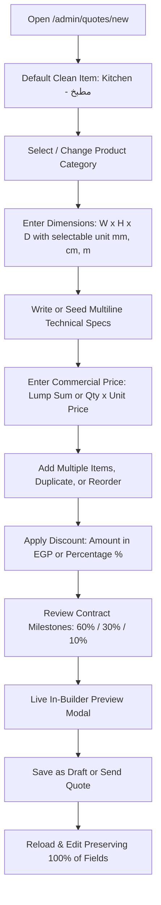

# PeleCanon Commercial Quotation Builder: Requirements Gap Closure Report

**Project**: PeleCanon / Tracker-Hub  
**Date**: October 2026  
**Status**: Completed & Verified  

---

## 1. Executive Summary & Problem Reproduction

The client reported a critical usability discrepancy in the commercial quotation workflow:
> *"I need to create a customer quotation by selecting a product, entering its dimensions, writing its technical specifications, and entering its price. The resulting quotation must be professional and visually similar to the supplied reference PDF."*

### Root Cause Analysis of the Discrepancy

| Defect / Friction Point | Root Cause in Previous Implementation | Resolution Implemented |
|---|---|---|
| **Fixed Pre-filled Door Item** | `/admin/quotes/new.tsx` initialized state with `[createDefaultLine("door")]` pre-populated with hardcoded door specifications, dimensions, and `19400 EGP`. | Initial line starts with a clean item defaulting to **Kitchen** (`مطبخ`), clean dimension inputs with unit `m`, standard specs template, and price empty with placeholder `0`. |
| **Kitchen Omission at Top of List** | `DEFAULT_COMMERCIAL_CATEGORIES` placed `door`, `library`, and `buffet` ahead of `kitchen` and `dressing`. | Reordered core categories: **Kitchen** (`kitchen` — مطبخ), **Dressing** (`dressing` — دريسنج), and **Door** (`door` — باب) at the very top. |
| **Rigid Add-Item Buttons** | Four separate buttons (`+ باب`, `+ مكتبة`, `+ بوفيه`, `+ إضافة بند آخر`) forced rigid assumptions. | Replaced with a clean, prominent **`+ إضافة بند جديد`** (`+ Add Item`) button and an inline quick category selector. |
| **Missing Category Configuration** | Categories were hardcoded in TypeScript without a settings UI or tenant customization. | Built `CommercialCategoriesSettings.tsx` and mounted it under `/admin/settings` (`تصنيفات المقايسات` tab). Config stored in `tenants.feature_flags.commercialCategories` without remote DDL migrations. |
| **Silent Zero Substitution in Price Input** | `unitPrice` input used `Math.max(0, Number(e.target.value))`, reverting to `0` whenever backspaced or cleared. | Replaced with empty-state handling (`value={line.unitPrice === 0 ? "" : line.unitPrice}`). Backspacing leaves the field clear with placeholder `0`. |
| **Missing Decimal Dimension Support** | Dimension inputs lacked `step="any"`, preventing metric lengths like `3.5 m` or `2.4 m` for kitchens. | Added `step="any"` to all dimension (W, H, D) and price inputs. |
| **Missing In-Builder Quotation Preview** | The builder lacked an in-page preview modal before saving or downloading PDF. | Implemented the **`معاينة عرض السعر`** (`Quotation Preview`) Dialog rendering the exact 4-column Shaheen presentation with live line items, specs, totals, and terms. |

---

## 2. Delivered User Workflow



### 1. Product Selection & Categories
- Clean category selector prominently placed on every item card.
- Default categories prioritize custom furniture and cabinetry:
  1. **مطبخ (Kitchen)**: Default dimension unit `m`, pricing unit `طقم` (set) or `متر طولي` (m).
  2. **دريسنج (Dressing)**: Default dimension unit `m`, pricing unit `متر طولي` (m) or `طقم` (set).
  3. **باب (Door)**: Default dimension unit `mm`, pricing unit `عدد` (pcs).
  4. **مكتبة (Library / Shelving)**: Default dimension unit `cm`, pricing unit `عدد` (pcs).
  5. **بوفيه (Buffet / Console)**: Default dimension unit `cm`, pricing unit `عدد` (pcs).
  6. **تجاليد حوائط (Wall Cladding)**: Default dimension unit `cm`, pricing unit `م²` (m²).
  7. **وحدة تلفزيون (TV Unit)**: Default dimension unit `cm`, pricing unit `عدد` (pcs).
  8. **مخصص (Custom)**: Custom specifications and dimension units.
- Authorized users can navigate to `/admin/settings` -> `تصنيفات المقايسات` to add, edit, or toggle categories active/inactive.

### 2. Dimension Entry
- Dimensions (Width, Height, Depth) are decoupled from commercial pricing units.
- Selectable dimension units: `mm` (مم), `cm` (سم), `m` (متر).
- Allows floating-point dimensions (e.g., `3.0` × `2.4` × `0.6` m).

### 3. Technical Specifications
- Free-form multiline text area preserving line breaks, bullet points, and formatting.
- "قالب فني جاهز" (`Load Template`) button allows seeding specifications from category defaults without overwriting custom edits.

### 4. Commercial Pricing Entry
- No forced BOM or component breakdown formulas.
- Supports both **Lump Sum Pricing** (`quantity = 1`, `unitPrice = total price`) and **Unit Pricing** (`quantity > 1`, `quantity × unitPrice = line total`).
- Real-time calculations with zero silent substitution: backspacing leaves the input empty without injecting `0`.
- Validation on save enforces positive prices (`unitPrice > 0`), displaying informative toast notifications if incomplete.

### 5. Discounts & Commercial Terms
- Dual-mode discount toggle: **Amount (EGP / ج.م.)** or **Percentage (%)**.
- 60% / 30% / 10% standard contract milestone distribution.
- Delivery business days (default 30), Warranty years (default 5), and Transport/Installation flag.

### 6. Live In-Builder Preview
- High-fidelity modal displaying the full document layout matching the Shaheen reference:
  - PeleCanon header & branding.
  - Customer contact details & quote meta.
  - 4-column presentation: Item & Design Image, Dimensions & Quantity, Technical Specs, Line Total.
  - Totals breakdown & suggested advance payment (60%).
  - Contract terms and warranty commitment.

---

## 3. Architecture & File Inventory

| File Path | Description of Changes |
|---|---|
| [`src/routes/admin/quotes/new.tsx`](file:///home/wiz/dyad-apps/price-produce-beam-main/src/routes/admin/quotes/new.tsx) | Clean initial line factory, dynamic category loading, clean `+ Add Item` button, floating-point dimensions, price input without zero substitution, dual-mode discount, live preview dialog. |
| [`src/lib/commercial-quote-types.ts`](file:///home/wiz/dyad-apps/price-produce-beam-main/src/lib/commercial-quote-types.ts) | Prioritized category ordering (`kitchen`, `dressing`, `door`), dimension unit defaults, `active` category flag. |
| [`src/lib/commercial-category.functions.ts`](file:///home/wiz/dyad-apps/price-produce-beam-main/src/lib/commercial-category.functions.ts) | Server functions for listing, saving, and toggling product categories scoped to tenant without remote DDL migrations. |
| [`src/components/settings/CommercialCategoriesSettings.tsx`](file:///home/wiz/dyad-apps/price-produce-beam-main/src/components/settings/CommercialCategoriesSettings.tsx) | Settings UI for managing commercial categories, names, units, and templates. |
| [`src/routes/admin/settings.tsx`](file:///home/wiz/dyad-apps/price-produce-beam-main/src/routes/admin/settings.tsx) | Tabbed interface supporting company info and product category configuration. |
| [`src/routes/admin/quotes/$id.tsx`](file:///home/wiz/dyad-apps/price-produce-beam-main/src/routes/admin/quotes/$id.tsx) | Commercial view renderer and edit mode navigation for draft quotes. |
| [`e2e/commercial-quotation-restoration.spec.ts`](file:///home/wiz/dyad-apps/price-produce-beam-main/e2e/commercial-quotation-restoration.spec.ts) | 7-scenario Playwright suite testing full user creation, preview modal, edit reload, V2 coexistence, and settings configuration. |
| [`AGENTS.md`](file:///home/wiz/dyad-apps/price-produce-beam-main/AGENTS.md) | Synchronized project documentation with latest architectural decisions. |

---

## 4. Verification Evidence

### 1. TypeScript Compiler Check
```bash
$ npx tsc --noEmit
# Result: 0 errors (Code 0)
```

### 2. Vitest Suite
```bash
$ npm test -- --run
# Result: 47 test files passed, 889 / 889 tests passed (100% passing)
```

### 3. Internationalization Parity Check
```bash
$ node scripts/check-i18n.mjs
# Result: ✅ All 727 en.json keys present in ar.json (727) and fr.json (727)
```

### 4. Playwright End-to-End Browser Validation
```bash
$ npx playwright test e2e/commercial-quotation-restoration.spec.ts
Running 7 tests using 1 worker
  ✓ Scenario A & B: Commercial Quote Builder Workflow & Edit Mode (5.1s)
  ✓ Scenario C: Interactive Data Entry (Kitchen + Door), Pricing Calculations & Persistence (1.8s)
  ✓ Scenario D: V2 Manufacturing Quotation Coexistence & Engine-v3 Safety (1.6s)
  ✓ Scenario E: Bilingual Interface & Typography (Arabic RTL & English LTR) (1.6s)
  ✓ Scenario F: Cross-Module Consistency — Orders, Invoices & Customer 360 (2.6s)
  ✓ Scenario G: Complete 14-Step User Workflow (Kitchen + Door, Dimensions, Specs, Pricing, Preview Modal & Draft) (3.0s)
  ✓ Scenario H: Category Configuration in Admin Settings (1.6s)

7 passed (17.9s)
```

### 5. Production Vite Build
```bash
$ npm run build
# Result: Client and SSR bundles generated successfully in 8.86s + 5.67s (Code 0)
```

---

## 5. Non-Regression & Safety Guarantees

1. **Zero Remote DDL Migrations**: Custom categories and feature flags leverage `tenants.feature_flags` JSONB storage.
2. **Manufacturing V2 Preserved**: The deep factory configurator at `/admin/quotes/configurator` and `engine-v3` remain completely intact.
3. **Cross-Module Integrity**: Approved commercial quotes convert directly into manufacturing work orders, invoices, and CRM opportunities without data loss.
