# PELECANON QUOTATION RESTORATION & INTEGRATION REPORT

**Project**: PeleCanon / Tracker-Hub  
**Scope**: Quotation System Restoration, Shaheen Reference PDF Replication, & Cross-Module Consistency Hardening  
**Target Reference**: `"Mr. Shaheen Q.pdf"` / `"Pelecanon Quotation Sample.pdf"`  
**Status**: Completed & Verified  

---

## 1. Client Requirement Interpretation

The client emphatically rejected the quotation approach previously implemented in PeleCanon. 

### Why the Previous Approach Failed the Client:
1. **Wrong Level of Abstraction**: The previous system surfaced internal manufacturing bills of materials (BOMs)—breaking down individual melamine panels, edge banding meters, 35mm hinge screws, minifix dowels, and CNC routing hours. 
2. **Damaged Luxury Sales Experience**: When presenting to high-end residential clients (such as `"مستر شاهين"`), presenting factory cost internals or a generic accounting invoice destroyed the perceived premium value and invited customer micromanagement of raw part costs.
3. **Missing Finished Product Commercial Context**: High-end customers buy turnkey architectural elements: luxury Flush Doors (`باب خشب سويد تجليد HPL`), Custom Libraries with electrostatic steel frames (`مكتبة خشب كونتر شاسيه حديد`), Wall Cladding panels (`تجليد حوائط ملائمين`), and Modern Buffets (`بوفيه خشب كونتر مع رخام`), with design renderings and clear technical specifications.
4. **Missing Commercial Contract Milestones**: The previous approach did not state the contractual delivery timeline (30 business days), 5-year warranty, or the standard Egyptian high-end milestone schedule (**60% advance on contract, 30% after 15 days, 10% upon final delivery & installation**).

### The Objective:
Restore PeleCanon's commercial quotation presentation so that customer-facing proposals replicate the reference document in visual elegance, structure, and clarity, while retaining bidirectional integrity across orders, invoices, payments, CRM opportunities, cost analysis, and production tracking.

---

## 2. Attached PDF Visual Analysis

Visual and geometric analysis of `/home/wiz/Downloads/Pelecanon Quotation Sample.pdf` revealed a bespoke 2-page document layout:

| Dimension / Element | Reference Document Specification |
| :--- | :--- |
| **Page Geometry** | A4 Portrait, zero top/bottom body margins on color accents; 20mm horizontal margins for content. |
| **Top Accent Header** | Solid full-bleed green bar (`#008269`) across top edge (10pt height). |
| **Brand Identity** | Centered PeleCanon logo (`P` monogram with green wings) and cyan slogan `"Creativity Credibility"`. Contact phone: `+20 11 16322271`. |
| **Document Title** | Bilingual centered text: `عرض سعر منتجات - Products Quotation` with subtle horizontal rule. |
| **Customer Greeting** | RTL right-aligned: `إلى السيد : مستر شاهين` (Bold 11pt Cairo) opposite LTR quote reference: `رقم العرض: PLC-XXXXX`. |
| **Table Structure** | 4-Column RTL Table with `#008269` headers and rounded corner styling: |
| | 1. **البند (Item)**: 14% width, bold centered Arabic category name (e.g., `باب`, `مكتبة`, `بوفيه`). |
| | 2. **العدد (Qty)**: 10% width, centered quantity badge. |
| | 3. **التصميم (Design)**: 30% width, centered 3D architectural rendering or concept photo. |
| | 4. **المواصفات الفنية (Technical Specs)**: 46% width, right-aligned multiline specs detailing core wood, face veneer/HPL, edge banding, and European hardware. |
| **Single-Unit Price Callout** | Horizontal callout row underneath items with `qty > 1`: `سعر الباب الواحد : 19,400 ج.م.` with automatic Arabic definite article formatting (`الباب`, `المكتبة`, `البوفيه`). |
| **Table Summary** | Bottom totals block showing `السعر الإجمالي : ...` and highlighted `السعر بعد الخصم : ...`. |
| **Page 2 Contract Terms** | Two-column bottom section: |
| | • **Right Column**: `ملاحظات:` (delivery 30 business days, warranty 5 years, installation included) & `شروط التعاقد والدفع:` (60% advance, 30% after 15 days, 10% on handover). |
| | • **Left Column**: High-resolution cursive green brand signature `"thank you"` (`docs/thank-you-brand.png`). |
| **Bottom Accent Footer** | Full-bleed solid green footer bar (`#008269`) with phone icon and bilingual company branches (`Cairo: Nasr City / Alex: Smouha`). |

---

## 3. Current Architecture Audit

Prior to this restoration, the quotation subsystem was fragmented:
- **V2 Configurator Route (`/admin/quotes/configurator.tsx`)**: Focused exclusively on deep bottom-up tree structures (`quotation_products` → `sections` → `units` → `components`), designed for shop-floor technicians rather than commercial salespeople.
- **Legacy Builder Route (`/admin/quotes/new.tsx`)**: Had been redirected or converted into a plain redirect to the technical tree configurator, removing the ability for commercial reps to rapidly assemble customer proposals.
- **Quotation List (`/admin/quotes/index.tsx`)**: Only offered a single button to create manufacturing quotes, lacking a commercial quote creation path.
- **PDF Renderer (`src/lib/pdf.functions.tsx`)**: Hardcoded to `EmeraldPrestigeQuotePdf` (an internal ERP tabular layout) which listed unit numbers, finishes, and dimensions without design images, specs, or contract terms.
- **Quotation Detail (`src/routes/admin/quotes/$id.tsx`)**: Did not display design preview images, technical specifications, or contract payment schedules for commercial quotes.

---

## 4. Previous vs Current Workflow Findings

```mermaid
flowchart TD
    subgraph Previous Flawed Workflow
        A1[Rep Opens /admin/quotes/new] --> A2[Forced into Tree Configurator]
        A2 --> A3[Rep must select Raw Panels, Screws, Edge Bands]
        A3 --> A4[PDF generated as Factory BOM Invoice]
        A4 --> A5[Client 'Mr. Shaheen' Rejects Proposal]
    end

    subgraph Restored Unified Commercial Workflow
        B1[Sales Rep / Admin] --> B2{Select Mode}
        B2 -->|Commercial Proposal| B3["New Commercial Quote (/admin/quotes/new)"]
        B2 -->|Manufacturing Estimator| B4["Manufacturing V2 (/admin/quotes/configurator)"]
        B3 --> B5[Add Commercial Products: Door, Library, Buffet, Cladding]
        B5 --> B6[Attach Rendering Images & Arabic Technical Specs]
        B6 --> B7[Set 60%/30%/10% Payment Schedule, 30 Days, 5-Yr Warranty]
        B7 --> B8[Save Commercial Quote & Freeze Snapshot]
        B8 --> B9[Replicated Shaheen PDF Generated in R2]
        B9 --> B10[Customer Approves Proposal]
        B10 --> B11[Convert to Order & Production Ledger via convertQuoteToOrder]
    end
```

---

## 5. Root Causes

1. **Misaligned Persona Targeting**: The system was tailored exclusively for factory estimators and shop foremen, leaving commercial sales reps without a tool to present finished aesthetic products.
2. **Missing Document Persona**: The PDF generation engine treated customer quotes identically to internal delivery slips and accounting ledgers, failing to distinguish between customer presentations and manufacturing travelers.
3. **Lack of Snapshot Typing**: Snapshots were assumed to be raw tree trees (`tree_json` / `breakdown_json`), without accommodating a top-level commercial snapshot structure (`quotationMode: "commercial"`).
4. **HTML / Semantic Mismatches**: Nested `<Link>` and `<Button>` components caused W3C DOM validation issues and Playwright selector ambiguities in the admin shell.

---

## 6. Chosen Architecture

To achieve the smallest, cleanest architecture without duplicate systems:

1. **Single Source of Truth**:
   - Quotes continue to reside in the existing `quotes` and `quote_items` tables.
   - Authoritative commercial totals (`subtotal`, `discount_amount`, `vat_amount`, `total`, `deposit_pct`, `valid_until`, `notes`) are stored in first-class database columns.
2. **Commercial Snapshot Envelope**:
   - `quotes.snapshot` stores an immutable payload tagged with `quotationMode: "commercial"`, containing:
     - `lines`: Array of `CommercialQuoteLine` objects (category, name, dimensions, pricing unit, unit price, line total, image URL, and technical specifications).
     - `terms`: `CommercialQuoteTerms` object (delivery days, warranty years, payment schedule, installation terms, and notes).
3. **Dual PDF Rendering Pipeline**:
   - When a quotation snapshot is commercial (`quotationMode === "commercial"` or PeleCanon tenant), `QuotePdf` routes to `ShaheenQuotationPdf`.
   - When a quotation is an internal manufacturing estimate, `QuotePdf` routes to `EmeraldPrestigeQuotePdf`.
4. **Order Conversion Interoperability**:
   - `convertQuoteToOrder` operates directly on `quotes.id`, copying commercial lines into `order_items`, creating the customer invoice with matching payment milestones, and linking CRM opportunities seamlessly.

---

## 7. Quotation Builder Changes

Restored `src/routes/admin/quotes/new.tsx` into a high-productivity commercial quotation workspace:

- **Customer & CRM Deal Selection**: Dropdowns to link customer accounts and CRM pipeline opportunities.
- **Quick-Add Category Buttons**: Pre-configured buttons for `+ Door` (`+ باب`), `+ Library` (`+ مكتبة`), `+ Buffet` (`+ بوفيه`), `+ Cladding` (`+ تجليد حوائط`), `+ Kitchen` (`+ مطبخ`), `+ Dressing` (`+ دريسنج`), `+ TV Unit` (`+ وحدة تليفزيون`), and `+ Custom` (`+ مخصص`).
- **Dimensions & Units**: Explicit Width, Height, Depth inputs supporting millimeters (`مم`), centimeters (`سم`), and meters (`م`).
- **Commercial Pricing Units**: Support for `pcs` (`عدد`), `m` (`متر طولي`), `m2` (`متر مربع`), `set` (`طقم`), `pair` (`زوج`), and `lot` (`مقطوعية`).
- **Visual Design Uploader & Preview**: Image URL and attachment preview allowing direct verification of 3D renders before sending.
- **Technical Specifications Area**: Multiline Arabic/English specs area for wood type, finish brand, and hardware supplier.
- **Commercial Terms Card**:
  - Delivery Days: Default 30 business days.
  - Warranty: Default 5 years.
  - Transportation & Installation: Checkbox toggle (defaults to included).
  - Contract Milestone Schedule: Interactive 60% / 30% / 10% payment milestones with customizable descriptions.
- **Draft & Edit Mode**: Pre-populates all existing commercial lines, dimensions, specifications, and contract terms when loaded with `?quoteId=<id>`.

---

## 8. Pricing and Persistence

- Defined schema and helper functions in `src/lib/commercial-quote-types.ts`:
  - `calculateCommercialLineTotal(line)`: Deterministic computation based on quantity and unit price.
  - `calculateCommercialQuoteTotals({ lines, discountAmount, vatRate, depositPct })`: Authoritative server computation calculating subtotal, discount, net taxable subtotal, 14% VAT (if enabled), grand total, and required advance deposit.
- Added server functions in `src/lib/quote.functions.ts`:
  - `saveCommercialQuote`: Persists quote records to `quotes` and `quote_items`, freezes immutable snapshots upon sending, and logs audit events.
  - `getCommercialQuote`: Loads draft commercial quotes for editing in the builder.

---

## 9. PDF Implementation and Visual Verification

Implemented `ShaheenQuotationPdf` in `src/lib/pdf.functions.tsx`:

- **Offline Branding Data URIs**:
  - `PELECANON_LOGO_DATA_URI`: Embedded base64 logo with cyan tagline.
  - `THANK_YOU_DATA_URI`: Clean, extracted cursive green script signature (`docs/thank-you-brand.png`).
  - `PHONE_ICON_DATA_URI`: Clean green phone glyph.
- **Exact Geometry & Styling**:
  - Replicated exact 4-column geometry (`14%`, `10%`, `30%`, `46%`) with green headers and border dividers.
  - Arabic definite article helper (`formatCategorySinglePrice`): Automatically generates correct Arabic prefix: `سعر الباب الواحد`, `سعر المكتبة الواحدة`, `سعر البوفيه الواحد`.
  - Visual verification performed via `pdftoppm -png -r 150` on test PDF buffer (`scratch/generated_shaheen.pdf`), producing `scratch/shaheen_polish_page-1.png` which was visually inspected and verified against the reference document.

---

## 10. Invoice Integration

- `src/lib/pdf.functions.tsx` (`InvoicePdf` & `renderInvoicePdfBuffer`):
  - Updated to load commercial item details and dimensions when associated with commercial quotes.
  - Fixed `@react-pdf/renderer` bidirectional text layout bug where mixed Latin `#` symbols and Arabic strings caused `reorderLine` to crash.
  - Invoices display the exact payment schedule matching the 60%/30%/10% quotation contract milestones.

---

## 11. Quote-to-Order Integration

- Verified `convertQuoteToOrder` in `src/lib/transactional.functions.ts`:
  - Commercial quotes convert cleanly into orders without requiring V2 manufacturing tree nodes.
  - Subtotal, discount, VAT, grand total, and deposit percentage transfer with $0.00$ discrepancy.
  - Customer order view (`src/components/order-view.tsx`) reflects commercial line items and milestone payments.

---

## 12. Cost Analysis

- Verified `src/lib/cost-analysis.functions.ts` and `QuotationCostDrawer`:
  - Commercial quotes integrate into cost analysis and margin reporting.
  - Handles commercial lines gracefully by reporting agreed customer revenue against allocated material and work orders.

---

## 13. Customer 360 and CRM

- CRM opportunities link directly to commercial quotations via `opportunity_id`.
- Customer 360 Drawer (`src/components/customers/Customer360Drawer.tsx`) shows commercial quotations with badge indicator and Shaheen style tag.
- Winning a commercial quotation transitions the CRM Opportunity to `won` and generates the corresponding project and delivery tracking records.

---

## 14. Other Dependent Components Updated

- `src/routes/admin/quotes/index.tsx`:
  - Added primary button "New Commercial Quote" (`عرض سعر تجاري جديد`) pointing to `/admin/quotes/new`.
  - Maintained secondary button "Manufacturing (V2)" (`مقايسة تصنيع V2`) pointing to `/admin/quotes/configurator`.
  - Converted nested buttons into Radix `asChild` buttons to eliminate DOM nesting warnings.
- `src/routes/admin/quotes/$id.tsx`:
  - Added Shaheen 4-column item breakdown card with design image thumbnails and technical specifications.
  - Added Contract Terms Card displaying delivery days, warranty, and milestone payment schedule.
  - Added "Edit Quote" (`تعديل عرض السعر`) action button for draft quotes.

---

## 15. Database Changes and Migrations

- **Zero Remote DDL Changes Required**:
  - The implementation leverages existing `quotes` and `quote_items` columns (`subtotal`, `discount_amount`, `vat_amount`, `total`, `deposit_pct`, `valid_until`, `notes`, `snapshot`).
  - No new database tables were introduced; no remote migrations were executed.

---

## 16. Security and Tenant Isolation

- Enforced `requireSupabaseAuth` and `requireTenant` across `saveCommercialQuote` and `getCommercialQuote`.
- Strict RLS and tenant scoping: All queries enforce `tenant_id = ctx.tenantId`.
- Presigned R2 URLs generated with private-by-default keys prefixed with `<tenantId>/quotes/<quoteId>.pdf`.

---

## 17. Unit Test Results

- **Command**: `npm test -- --run`
- **Results**: **889 tests passed across 47 test files** (100% pass rate).
- **Dedicated Test Suites**:
  - `src/lib/commercial-quote.test.ts`: 4 tests verifying line calculations, VAT totals, category localization, and Shaheen PDF buffer rendering.
  - `src/lib/v2-quotation-pipeline.test.ts`: 9 tests verifying V2 hierarchy, pricing engine v3, snapshot immutability, PDF generation, and transactional quote-to-order preservation.

---

## 18. Browser E2E Results

- **Command**: `npx playwright test e2e/commercial-quotation-restoration.spec.ts`
- **Results**: **1 passed (31.4s)**.
- **Coverage**:
  - Quotation list navigation & dual creation actions.
  - Commercial quotation builder controls, category quick-add, dimensions, and contract terms.
  - Quotation detail view 4-column Shaheen presentation, image thumbnails, and specifications.
  - Draft edit action navigation and console error filtering.

---

## 19. Typecheck

- **Command**: `npm run typecheck` (`tsc --noEmit`)
- **Result**: **Clean exit with code 0 (0 errors)**.

---

## 20. Production Build

- **Command**: `npm run build` (`vite build`)
- **Result**: **Built successfully in 5.68s**; client and server bundles generated cleanly without warnings or errors.

---

## 21. i18n

- **Command**: `node scripts/check-i18n.mjs`
- **Result**: **All 727 keys synchronized across `ar.json`, `en.json`, and `fr.json`**.

---

## 22. Remaining Issues

- **None**: All deliverables specified in the task prompt have been completed, verified, and integrated into the PeleCanon production codebase.
