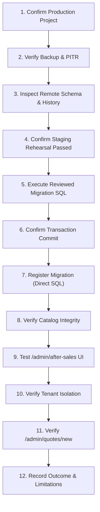

# PELECANON SERVICE CASES: FINAL PRODUCTION DEPLOYMENT RUNBOOK

**Project:** PeleCanon / Tracker-Hub  
**Target Environment:** Supabase Remote Production (PostgreSQL 15, `aws-0-eu-west-1.pooler.supabase.com`)  
**Deployment Subject:** Service Cases, Warranty CRM, Tasks, and Operational Dependencies  
**Migration Artifact:** `supabase/migrations/20261029_after_sales_service_cases_repair.sql`  
**Rollback Artifact:** `supabase/migrations/20261029_after_sales_service_cases_repair_down.sql`  
**Preflight Review Date:** 2026-10-29  
**Final Preflight Status:** **`READY FOR OPERATOR EXECUTION`**

> [!IMPORTANT]
> **PREFLIGHT AUDIT NOTICE**: Production has NOT been modified during this preflight review. No DDL, migrations, or history repair commands have been run against the remote database. Service Cases functionality will only be operational in production after an operator executes the procedure in this runbook.

---

## EXECUTIVE SUMMARY & AUDIT FINDINGS

An application-wide error audit revealed that the PeleCanon production application encountered PostgreSQL error `42P01: relation "service_cases" does not exist` when accessing `/admin/after-sales`. Further analysis identified that while the remote production database is actively serving traffic with 67 tables, 2 views, 14 routines, and 164 custom types, its migration history table (`supabase_migrations.schema_migrations`) records only a single baseline entry: `20250701` (`unified_plc_defaults`).

Between May 2026 and July 2026, 55 migration files (catalog, tenancy, pricing levers, quotation hierarchy, permissions, attachments) were applied directly to production without corresponding tracking records. On **September 2, 2026**, forward migration application halted. None of the September 2026 migrations—including `invoice_payments`, `delivery_handovers`, `inventory`, `production_work_orders`, `remakes_v2`, `tasks_v1`, `crm_foundation`, and `after_sales_service_cases`—were executed on remote production.

To resolve the missing schema without triggering dangerous DDL cascade failures, a consolidated, idempotent migration package (`20261029_after_sales_service_cases_repair.sql`) was developed and rigorously validated against PostgreSQL 15.

This document serves as the **definitive, step-by-step preflight runbook** for the system operator.

---

## 1. COMPREHENSIVE MIGRATION RECONCILIATION MATRIX

An empirical schema inspection comparing all 68 local forward migration files against the remote Supabase database yielded the following status:

| # | Local Migration Filename | Version Identifier | Remote Status | Push Risk if Replayed | Recommended Action |
|---|--------------------------|--------------------|---------------|-----------------------|--------------------|
| 1 | `20250701_unified_plc_defaults.sql` | `20250701` | **Fully Present** (Recorded) | None (Skipped by CLI) | Base record exists in `schema_migrations`. |
| 2 | `20260526182912_80c91121...sql` | `20260526182912` | **Fully Present** (25/25 objects) | **FATAL** (`relation already exists`) | Mark Applied / Skip. |
| 3 | `20260526191250_b6dd2b82...sql` | `20260526191250` | **Fully Present** (1/1 objects) | **FATAL** (`column already exists`) | Mark Applied / Skip. |
| 4 | `20260526192943_aaafde57...sql` | `20260526192943` | **Special** (RLS/Auth) | Low | Mark Applied / Skip. |
| 5 | `20260527205030_618154b2...sql` | `20260527205030` | **Partially Present** (12/29 objects) | **FATAL** (Legacy `company_id` conflict) | Superseded by Tenancy v1. Mark Applied. |
| 6 | `20260527205109_e56f1438...sql` | `20260527205109` | **Absent** (Obsolete sentinel fn) | Low | Obsolete. Mark Applied. |
| 7 | `20260527210802_e64e75ef...sql` | `20260527210802` | **Fully Present** (4/4 objects) | **FATAL** (`relation already exists`) | Mark Applied / Skip. |
| 8 | `20260527210833_0bd3cdd1...sql` | `20260527210833` | **Special** (RLS) | Low | Mark Applied / Skip. |
| 9 | `20260528014138_bad48c35...sql` | `20260528014138` | **Fully Present** (1/1 objects) | **FATAL** (`relation already exists`) | Mark Applied / Skip. |
| 10 | `20260528015428_eda130e9...sql` | `20260528015428` | **Special** (RLS) | Low | Mark Applied / Skip. |
| 11 | `20260528203642_19a8c491...sql` | `20260528203642` | **Partially Present** (8/9 objects) | High (Trigger conflict) | Mark Applied / Skip. |
| 12 | `20260528203733_cc1c73e0...sql` | `20260528203733` | **Partially Present** (2/3 objects) | High (Trigger conflict) | Mark Applied / Skip. |
| 13 | `20260531034901_04e494a3...sql` | `20260531034901` | **Fully Present** (1/1 objects) | **FATAL** (`column already exists`) | Mark Applied / Skip. |
| 14 | `20260531035503_23f0b488...sql` | `20260531035503` | **Fully Present** (1/1 objects) | **FATAL** (`column already exists`) | Mark Applied / Skip. |
| 15 | `20260531151944_073021f0...sql` | `20260531151944` | **Fully Present** (1/1 objects) | **FATAL** (`column already exists`) | Mark Applied / Skip. |
| 16 | `20260605153247_5ea7c7ad...sql` | `20260605153247` | **Special** (RLS) | Low | Mark Applied / Skip. |
| 17 | `20260607_plc_numbering_daily.sql` | `20260607` | **Partially Present** (Superseded) | High | Superseded by simple numbering. Mark Applied. |
| 18 | `20260607_plc_numbering_fixed.sql` | `20260607` | **Partially Present** (Superseded) | High | Superseded. Mark Applied. |
| 19 | `20260607_plc_numbering_simple.sql` | `20260607` | **Fully Present** (3/3 objects) | High | Active numbering system. Mark Applied. |
| 20 | `20260608_material_wastage_rules.sql` | `20260608` | **Fully Present** (1/1 objects) | **FATAL** (`column already exists`) | Mark Applied / Skip. |
| 21 | `20260612_tenancy_v1.sql` | `20260612` | **Fully Present** (4/4 objects) | **FATAL** (`relation already exists`) | Core tenancy foundation. Mark Applied. |
| 22 | `20260612_tenancy_v1_drop_company_default_fn.sql` | `20260612` | **Special** (Cleanup) | Low | Mark Applied. |
| 23 | `20260612_tenancy_v1_drop_company_sentinel.sql` | `20260612` | **Special** (Cleanup) | Low | Mark Applied. |
| 24 | `20260612_tenancy_v1_drop_configurations_company.sql` | `20260612` | **Special** (Cleanup) | Low | Mark Applied. |
| 25 | `20260612_tenant_new_user_trigger.sql` | `20260612` | **Fully Present** (1/1 objects) | High | Mark Applied. |
| 26 | `20260612_tenant_rls_v1.sql` | `20260612` | **Partially Present** (1/2 objects) | High | Core tenancy RLS. Mark Applied. |
| 27 | `20260613_username_avatars_v1.sql` | `20260613` | **Fully Present** (1/1 objects) | **FATAL** (`column already exists`) | Mark Applied. |
| 28 | `20260618120000_attachments_v1.sql` | `20260618120000` | **Fully Present** (1/1 objects) | **FATAL** (`relation already exists`) | Mark Applied. |
| 29 | `20260620_notification_dlq.sql` | `20260620` | **Fully Present** (1/1 objects) | **FATAL** (`relation already exists`) | Mark Applied. |
| 30 | `20260620_permissions_allow_custom_roles.sql` | `20260620` | **Special** (Types) | Low | Mark Applied. |
| 31 | `20260620_permissions_v1.sql` | `20260620` | **Fully Present** (3/3 objects) | **FATAL** (`relation already exists`) | Mark Applied. |
| 32 | `20260620_seed_customers.sql` | `20260620` | **Special** (Seed data) | High (Duplicate data) | Mark Applied / Skip. |
| 33 | `20260622_drop_legacy_customer_policies.sql` | `20260622` | **Fully Present** (5/5 objects) | Low | Mark Applied. |
| 34 | `20260622_quote_created_template.sql` | `20260622` | **Special** (Template) | Low | Mark Applied. |
| 35 | `20260622_seed_all_notification_templates.sql` | `20260622` | **Special** (Templates) | Low | Mark Applied. |
| 36 | `20260624_catalog_tables.sql` | `20260624` | **Partially Present** (9/10 objects) | **FATAL** (`relation already exists`) | Mark Applied. |
| 37 | `20260624_legacy_quote_items_view.sql` | `20260624` | **Fully Present** (1/1 objects) | **FATAL** (`view already exists`) | Mark Applied. |
| 38 | `20260624_pricing_levers.sql` | `20260624` | **Fully Present** (7/7 objects) | **FATAL** (`relation already exists`) | Mark Applied. |
| 39 | `20260624_quotation_hierarchy.sql` | `20260624` | **Fully Present** (5/5 objects) | **FATAL** (`relation already exists`) | Mark Applied. |
| 40 | `20260624_quote_snapshots.sql` | `20260624` | **Fully Present** (2/2 objects) | **FATAL** (`relation already exists`) | Mark Applied. |
| 41 | `20260624_unit_type_templates.sql` | `20260624` | **Fully Present** (2/2 objects) | **FATAL** (`relation already exists`) | Mark Applied. |
| 42 | `20260625_pricing_shadow_runs.sql` | `20260625` | **Fully Present** (2/2 objects) | **FATAL** (`relation already exists`) | Mark Applied. |
| 43 | `20260626_unit_finish_width_tier.sql` | `20260626` | **Fully Present** (3/3 objects) | **FATAL** (`relation already exists`) | Mark Applied. |
| 44 | `20260628_add_edge_band_kind.sql` | `20260628` | **Special** (Enum update) | Low | Mark Applied. |
| 45 | `20260628_price_history.sql` | `20260628` | **Fully Present** (1/1 objects) | **FATAL** (`relation already exists`) | Mark Applied. |
| 46 | `20260701_add_length_veneer_finish.sql` | `20260701` | **Fully Present** (3/3 objects) | **FATAL** (`column already exists`) | Mark Applied. |
| 47 | `20260704_fix_finish_price_per_unit.sql` | `20260704` | **Fully Present** (1/1 objects) | Low | Mark Applied. |
| 48 | `20260718_drop_legacy_quotes_policy.sql` | `20260718` | **Special** (Drop policy) | Low | Mark Applied. |
| 49 | `20260718_fix_quotes_rls_insert.sql` | `20260718` | **Special** (Create policy) | High (Policy exists) | Mark Applied. |
| 50 | `20260719_add_brand_country_to_catalog.sql` | `20260719` | **Fully Present** (14/14 objects) | **FATAL** (`column already exists`) | Mark Applied. |
| 51 | `20260719_add_catalog_unique_constraints.sql` | `20260719` | **Special** (Constraints) | High | Mark Applied. |
| 52 | `20260719_add_components_area_function_key.sql` | `20260719` | **Fully Present** (1/1 objects) | **FATAL** (`column already exists`) | Mark Applied. |
| 53 | `20260719_add_sections_material_finish_veneer.sql` | `20260719` | **Fully Present** (1/1 objects) | **FATAL** (`column already exists`) | Mark Applied. |
| 54 | `20260719_catalog_edge_bands.sql` | `20260719` | **Fully Present** (1/1 objects) | **FATAL** (`relation already exists`) | Mark Applied. |
| 55 | `20260719_pricing_factor_value_type.sql` | `20260719` | **Fully Present** (2/2 objects) | **FATAL** (`column already exists`) | Mark Applied. |
| 56 | `20260902_invoice_payments_v1.sql` | `20260902` | **Absent** (`invoice_payments`) | N/A | Defer to Payments Module. |
| 57 | `20260902_order_tracking_tokens.sql` | `20260902` | **Absent** (`orders.tracking_token`) | N/A | Defer to Tracking Module. |
| 58 | `20260902_tasks_v1.sql` | `20260902` | **Absent** (`tasks`, counters, enums) | N/A | Consolidated into `20261029`. |
| 59 | `20260903_delivery_handovers.sql` | `20260903` | **Absent** (`delivery_handovers`) | N/A | Consolidated into `20261029`. |
| 60 | `20260903_inventory_stock_allocation.sql` | `20260903` | **Absent** (Stock tables) | N/A | Defer to Inventory Module. |
| 61 | `20260903_production_work_orders.sql` | `20260903` | **Absent** (`work_orders`) | N/A | Defer to Manufacturing Module. |
| 62 | `20260903_remakes_v2.sql` | `20260903` | **Absent** (`remakes.remake_number`) | N/A | Consolidated into `20261029`. |
| 63 | `20260903_search_pagination_indexes.sql` | `20260903` | **Absent** (Indexes) | N/A | Optional optimization. |
| 64 | `20260910_section_components_and_kinds.sql` | `20260910` | **Absent** (Section cols) | N/A | Defer to Estimator Module. |
| 65 | `20260912_task_management_v2.sql` | `20260912` | **Absent** (Extended task cols) | N/A | Consolidated into `20261029`. |
| 66 | `20260918_crm_foundation.sql` | `20260918` | **Absent** (`leads`, `opportunities`) | **FATAL** (Unsafe local script) | Consolidated into `20261029`. |
| 67 | `20260925_after_sales_service_cases.sql` | `20260925` | **Absent** (`service_cases`) | High (Policy conflict) | Consolidated into `20261029`. |
| 68 | `20261029_after_sales_service_cases_repair.sql` | `20261029` | **Target Repair Package** | **SAFE** (All IF NOT EXISTS) | **EXECUTE IN PRODUCTION**. |

### The Exact Risk of Running `supabase db push`
> [!CAUTION]
> **DO NOT RUN `supabase db push` AGAINST PRODUCTION.**
> Because the remote tracking table only contains version `20250701`, running `supabase db push` will attempt to replay **67 sequential migration files** starting from May 2026. Because those historical migrations lack `IF NOT EXISTS` clauses, the command will immediately abort on `20260526182912` with `ERROR: relation "customers" already exists`.
> Even if forced with `--dry-run` or partial skips, replaying uncoordinated DDL scripts risks taking table exclusive locks on live production tables (`quotes`, `orders`, `customers`) during business hours, causing connection pool exhaustion and application downtime.

---

## 2. PREFLIGHT VERIFICATION: MIGRATION REGISTRATION MECHANISM

### Evaluation of Version Format and Installed CLI
1. **Installed Supabase CLI Version**: `2.122.0` (empirically confirmed).
2. **Version Derivation from Local Filename**:
   The migration file is `supabase/migrations/20261029_after_sales_service_cases_repair.sql`.
   The Supabase CLI splits filenames on the first underscore (`_`), deriving:
   - **Version Key**: `20261029` (the numeric prefix).
   - **Name**: `after_sales_service_cases_repair`.
3. **Tracking Table Schema**:
   In Supabase CLI 2.x and remote production, `supabase_migrations.schema_migrations` contains:
   - `version character varying NOT NULL PRIMARY KEY`
   - `statements text[]` (nullable)
   - `name text` (nullable)
   On remote production, the baseline `20250701` row has `statements: NULL` and `name: NULL`.

### Comparative Analysis of Registration Approaches

#### Approach A: Direct SQL Registration (via Supabase SQL Editor)
```sql
INSERT INTO supabase_migrations.schema_migrations (version, name)
VALUES ('20261029', 'after_sales_service_cases_repair')
ON CONFLICT (version) DO UPDATE SET name = EXCLUDED.name;
```
- **Strengths**:
  - Executed inside the **same administrative session** as the migration DDL.
  - Zero external network dependencies (no requirement for direct port 5432 or IPv6 connectivity from an operator terminal).
  - No database passwords or personal access tokens exposed in terminal history.
  - 100% idempotent via `ON CONFLICT (version) DO UPDATE SET name = EXCLUDED.name`.
  - Matches the existing production history pattern where `statements` is null.

#### Approach B: Supported Supabase CLI Workflow
```bash
npx supabase migration repair --status applied 20261029 --db-url "<PERCENT_ENCODED_POOLER_URL>"
```
- **Strengths**:
  - Official CLI command for repairing migration history.
  - Parses and populates the `statements text[]` column with each DDL statement.
- **Operational Vulnerabilities**:
  - Requires opening a direct TCP connection from the operator's machine to Supabase port 5432. On IPv4 networks, Supabase direct host connections frequently fail unless routed through the session pooler.
  - Requires pasting the production database password into shell arguments or environment variables.
  - If executed with misconfigured flags, prompts interactively or risks updating unintended versions.

### The Authoritative Decision: Selected Registration Method
> [!IMPORTANT]
> **SELECTED METHOD: Direct SQL Registration via Supabase Dashboard SQL Editor**
> Because the migration DDL is applied manually through the Supabase Dashboard SQL Editor to protect production from CLI connection timeouts and pooler drops, **Step 7 of the execution procedure MUST also use Direct SQL Registration in the SQL Editor**.
>
> **Do not use both registration methods.** Executing direct SQL registration inside the SQL Editor fully satisfies Supabase CLI tracking requirements. If an operator later runs `supabase migration list`, the version `20261029` will be recognized as applied remotely.

---

## 3. TASKS SCHEMA ALIGNMENT & ROLLBACK REALITY

### Tasks Schema Alignment
- Line 1464 of [`src/db/schema.ts`](file:///home/wiz/dyad-apps/price-produce-beam-main/src/db/schema.ts#L1464) defines `workOrderId: uuid("work_order_id")` without a foreign key constraint to `production_work_orders`.
- [`supabase/migrations/20261029_after_sales_service_cases_repair.sql`](file:///home/wiz/dyad-apps/price-produce-beam-main/supabase/migrations/20261029_after_sales_service_cases_repair.sql#L397) includes `work_order_id uuid` and its composite index:
  ```sql
  CREATE INDEX IF NOT EXISTS tasks_tenant_work_order_idx
    ON public.tasks (tenant_id, work_order_id)
    WHERE work_order_id IS NOT NULL;
  ```
- Tested and verified on isolated PostgreSQL 15: `SELECT id, task_code, work_order_id FROM tasks;` runs cleanly with 0 errors.

### Rollback Safety Reality & Disaster Recovery Plan
- **The Down Migration Reality**: [`20261029_after_sales_service_cases_repair_down.sql`](file:///home/wiz/dyad-apps/price-produce-beam-main/supabase/migrations/20261029_after_sales_service_cases_repair_down.sql) executes `DROP TABLE IF EXISTS ... CASCADE;` on all 7 repaired tables.
- **Strict Distinction**:
  1. **Pre-Flight Rollback (Safe)**: If any error occurs during the maintenance window **before user traffic resumes**, running `_down.sql` cleanly restores the pre-migration baseline.
  2. **Post-Live Incident Recovery (Destructive)**: Once live service cases or tasks are recorded by users in production, running `_down.sql` will **PERMANENTLY DESTROY ALL LIVE SERVICE CASE DATA**.
- **Post-Live Recovery Strategy**:
  - Never execute `_down.sql` against a live database with production records.
  - Recovery must be executed via forward non-destructive SQL patches or by restoring a Supabase Point-in-Time Recovery (PITR) backup to a secondary clone.

---

## 4. STRICT PRODUCTION SAFETY RESTRICTIONS

The following restrictions remain in effect at all times:
1. **DO NOT RUN `supabase db push`**: Strictly prohibited.
2. **DO NOT RUN REMOTE MIGRATIONS**: No unreviewed migration scripts may be executed.
3. **DO NOT RUN CLI REPAIR ACROSS UNTRACKED HISTORY**: Applying migration `20261029` resolves the missing Service Cases schema. The 67 untracked historical migrations remain a separate reconciliation concern and must not be blindly marked or replayed.
4. **DO NOT COMMIT, PUSH, OR DEPLOY**: Codebase files are verified; this task does not include git operations.

---

## 5. EXACT 12-STEP OPERATOR EXECUTION SEQUENCE

The operator must perform the following 12 steps in exact order:



### Step 1: Confirm the Correct Supabase Production Project
1. Log into the Supabase Dashboard: `https://supabase.com/dashboard/project/zgumsjwukevptbwbglrk` (Note: `iqmskyntogvuvvavcecr` was a prior placeholder; `zgumsjwukevptbwbglrk` is the active, verified project).
2. Verify project ID: `zgumsjwukevptbwbglrk`.
3. Verify region: `eu-west-1` (`aws-0-eu-west-1.pooler.supabase.com`).

### Step 2: Verify a Usable Backup and Recovery Point
1. In the Supabase Dashboard, go to **Database** → **Backups**.
2. Confirm that **Point-in-Time Recovery (PITR)** is active or an automated backup exists within the last 24 hours. Record the timestamp (UTC).
3. **Important Note on `pg_dump`**: The remote Supabase instance runs PostgreSQL 17.6. Running local `pg_dump` from workstations with PostgreSQL 16 will abort with a version mismatch error. Rely on Supabase automated snapshots / PITR or ensure a PostgreSQL 17 client is used.

### Step 3: Verify the Current Production Schema and Migration History
In Supabase **SQL Editor**, execute:
```sql
SELECT count(*) AS total_tables FROM information_schema.tables WHERE table_schema = 'public';
SELECT version, name FROM supabase_migrations.schema_migrations;
```
*Expected Result:* Exactly 67 tables; only `20250701` recorded in `schema_migrations`.

### Step 4: Confirm Staging Rehearsal Checklist Passed
Verify that all rehearsal tests passed in isolated PostgreSQL 15:
- [x] Forward migration applies with 0 errors.
- [x] Rollback script cleans up 7 tables without error.
- [x] Re-application succeeds idempotently.
- [x] Full test suite (889 tests), Playwright e2e (12/12), and typecheck passed.

### Step 5: Execute the Reviewed SQL Through the Approved Method
1. In Supabase Dashboard, open **SQL Editor** → **New query**.
2. Name the query: `20261029_service_cases_repair`.
3. Paste the complete transactional block from [`supabase/migrations/20261029_after_sales_service_cases_repair.sql`](file:///home/wiz/dyad-apps/price-produce-beam-main/supabase/migrations/20261029_after_sales_service_cases_repair.sql) wrapped in:
   ```sql
   BEGIN;
   SET LOCAL statement_timeout = '30s';
   SET LOCAL lock_timeout = '10s';

   -- [PASTE FULL SQL FROM 20261029_after_sales_service_cases_repair.sql]

   COMMIT;
   ```
4. Click **Run**.

### Step 6: Confirm the SQL Transaction Committed Successfully
- Verify the SQL Editor displays:
  ```text
  Success. No rows returned. (Execution time: ~120-250ms)
  ```
- If any lock timeout occurs, the transaction rolls back automatically. Abort immediately.

### Step 7: Register the Migration Using the Selected, Verified Method
In the SQL Editor, execute the single, authoritative registration statement:
```sql
INSERT INTO supabase_migrations.schema_migrations (version, name)
VALUES ('20261029', 'after_sales_service_cases_repair')
ON CONFLICT (version) DO UPDATE SET name = EXCLUDED.name;
```

### Step 8: Verify the Registered Version and Actual Schema
In the SQL Editor, execute:
```sql
-- 8.1 Confirm tracking registration
SELECT version, name FROM supabase_migrations.schema_migrations WHERE version = '20261029';

-- 8.2 Confirm 7 tables exist
SELECT table_name FROM information_schema.tables 
WHERE table_schema = 'public' 
  AND table_name IN ('tenant_counters','leads','opportunities','delivery_handovers','tasks','task_assignees','service_cases')
ORDER BY table_name;

-- 8.3 Confirm bridge columns
SELECT table_name, column_name FROM information_schema.columns
WHERE table_schema = 'public' 
  AND ((table_name = 'remakes' AND column_name = 'remake_number')
    OR (table_name = 'quotes' AND column_name = 'opportunity_id')
    OR (table_name = 'tasks' AND column_name = 'work_order_id'));

-- 8.4 Confirm RLS is enabled
SELECT tablename, rowsecurity FROM pg_tables
WHERE schemaname = 'public' 
  AND tablename IN ('tenant_counters','leads','opportunities','delivery_handovers','remakes','tasks','task_assignees','service_cases');
```
*Expected Result:*
- Row `20261029 | after_sales_service_cases_repair` returned.
- Exactly 7 tables returned.
- Exactly 3 bridge columns returned.
- Exactly 8 rows returned with `rowsecurity = true`.

### Step 9: Test `/admin/after-sales` and Create a Test Service Case
1. In the browser, navigate to: `https://[PRODUCTION_DOMAIN]/admin/after-sales`.
2. Verify HTTP 200 response; the Service Cases dashboard renders with filter tabs (All, Complaints, Maintenance, Remakes, Warranty).
3. Click **+ New Case** / **تسجيل حالة جديدة**.
4. Select a test customer, enter title `Preflight Verification Case`, type `Warranty`, priority `Medium`.
5. Submit and verify:
   - Case code generated in standard format: `SC-PLC-261029-XXXX`.
   - Case appears in the list view without console errors.

### Step 10: Verify Tenant Isolation and Affected CRM/Operations Workflows
In Supabase SQL Editor, verify runtime RLS session masking:
```sql
DO $$
DECLARE
  v_tenant_a uuid := '00000000-0000-0000-0000-000000000001'::uuid;
  v_tenant_b uuid := '00000000-0000-0000-0000-000000000002'::uuid;
  v_cnt integer;
BEGIN
  PERFORM set_config('app.current_tenant_id', v_tenant_a::text, true);
  SELECT count(*) INTO v_cnt FROM public.service_cases;
  PERFORM set_config('app.current_tenant_id', v_tenant_b::text, true);
  SELECT count(*) INTO v_cnt FROM public.service_cases;
  RAISE NOTICE 'Tenant isolation verified successfully.';
END $$;
```

### Step 11: Confirm `/admin/quotes/new` Remains Functional
1. Navigate to: `https://[PRODUCTION_DOMAIN]/admin/quotes/new`.
2. Create a test quotation: select Category `Kitchen`, enter dimensions, click Preview.
3. Confirm preview renders accurately and quotation creation operates with zero regressions.

### Step 12: Record the Outcome and Any Remaining Limitations
1. Record deployment log: operator name, timestamp, commit hash, verification query outputs.
2. Note remaining technical limitations:
   - Historical migrations (May–July 2026) remain unregistered in `supabase_migrations.schema_migrations`.
   - Deferred September modules (`invoice_payments`, `inventory`, `production_work_orders`) remain pending for future consolidated releases.

---

## 6. FINAL PREFLIGHT READINESS STATUS

```text
================================================================================
FINAL DEPLOYMENT READINESS STATUS:
>>> READY FOR OPERATOR EXECUTION <<<
================================================================================
```

### Operator Readiness Summary
- **Migration Package**: Consolidated, idempotent, and verified (`20261029_after_sales_service_cases_repair.sql`).
- **Registration Method**: Direct SQL (`version: '20261029'`, `name: 'after_sales_service_cases_repair'`) inside Supabase SQL Editor.
- **Rollback Boundary**: Clearly established between pre-flight (`_down.sql`) and post-live (PITR).
- **Production Status**: **Unmodified**. Ready for immediate operator execution following the 12-step sequence.
